# 🌐 LangGraph Agentic Workflows Architecture Guide

This directory provides a production-grade masterclass in **Agentic Workflows** built with **LangGraph**, **LangChain**, and high-performance open LLMs (via Groq/Google with automatic multi-model fallback).

---

## 🧭 Why Workflows Over Autonomous Agents?

Unlike fully open-ended agents that run in unconstrained loops deciding their own tools and paths, **Agentic Workflows** enforce a well-defined state graph. They offer:
- **Predictable SLAs & Lower Latency**: Bounded graph traversal instead of open-ended recursion.
- **Cost & Token Efficiency**: Minimized redundant reasoning steps.
- **Auditability & Observability**: Every state transition is recorded and inspectable.
- **Safety & Compliance**: Deterministic guardrails, approval gates, and human oversight.

<div align="center">

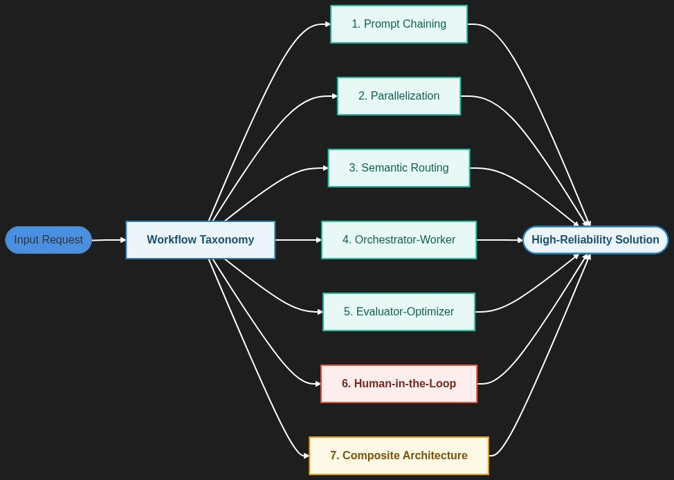

</div>

<details><summary>🔍 <b>View Mermaid Architecture Code</b></summary>

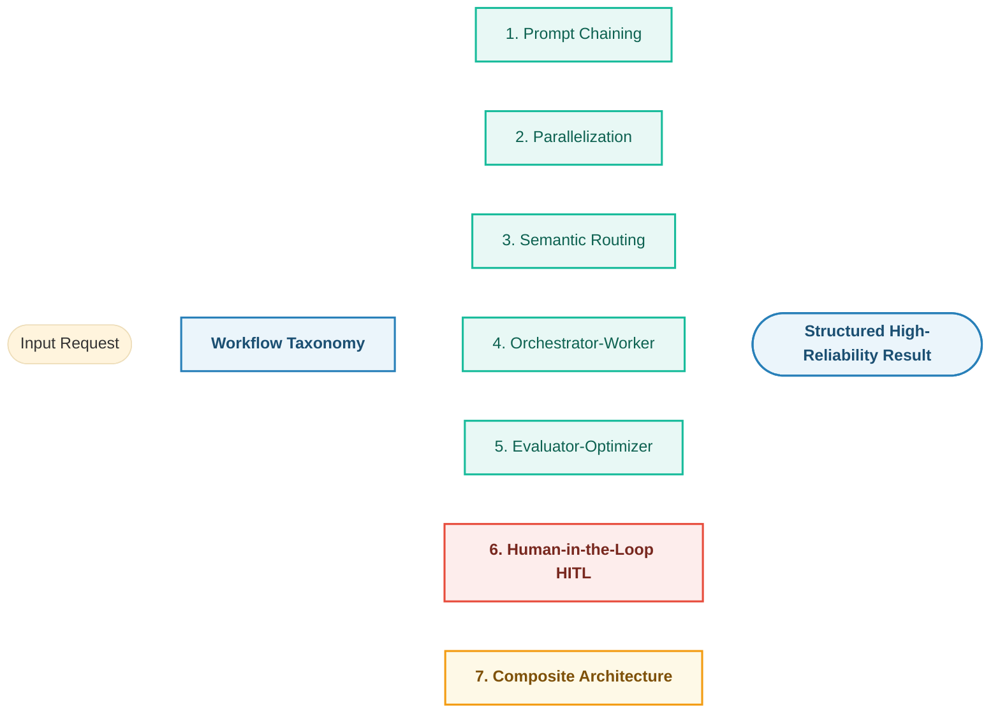
</details>

---

## 📂 Notebook Catalog

| Notebook | Pattern | Focus & Production Use Case |
| :--- | :--- | :--- |
| **`0-master_agentic_workflows.ipynb`** | **Masterclass (All 7 Patterns)** | Unified guide combining Prompt Chaining, Parallelization, Routing, Orchestrator-Worker, Evaluator-Optimizer, HITL, and Composite pipelines in one comprehensive notebook. |
| **`1-prompting_chaining.ipynb`** | **Prompt Chaining** | Sequential pipeline: Raw text generation $\to$ critique/formatting $\to$ final polish. |
| **`2-parallelization.ipynb`** | **Parallelization (Sectioning)** | Concurrent generation: Brainstorming multiple independent sections simultaneously and merging. |
| **`3-Routing.ipynb`** | **Semantic Routing** | Dynamic classification: Routing user queries to specialist nodes (Math, General, Coding). |
| **`4-orchestrator-worker.ipynb`** | **Orchestrator-Worker** | Dynamic map-reduce: Central planner creates dynamic subtasks and delegates via `Send` API to parallel workers. |
| **`5-Evaluator-optimizer.ipynb`** | **Evaluator-Optimizer Loop** | Quality refinement loop: Generator proposes solution, Evaluator scores rubric, loops until passing threshold. |
| **`6-human_in_the_loop_workflow.ipynb`** | **Human-in-the-Loop (HITL)** | Safety approval gate: `MemorySaver` checkpointer, `interrupt()`, and `Command(resume=...)` for mission-critical infrastructure deployments. |

---

## 🎨 Visual Architecture of the Core Workflow Patterns

### 1. Prompt Chaining (Sequential)
Decomposes a complex task into a fixed sequence of discrete LLM processing steps.

<div align="center">


</div>

<details><summary>🔍 <b>View Mermaid Architecture Code</b></summary>

```mermaid
%%{init: {'theme': 'base', 'themeVariables': { 'lineColor': '#ffffff'}}}%%
flowchart LR
    classDef startNode fill:#EBF5FB,stroke:#2980B9,stroke-width:2px,color:#1B4F72;
    classDef procNode fill:#E8F8F5,stroke:#16A085,stroke-width:2px,color:#0E6251;
    classDef endNode fill:#EAFAF1,stroke:#27AE60,stroke-width:2px,color:#145A32;

    START([Input Request]):::startNode --> Step1[Step 1: Extract Key Facts]:::procNode
    Step1 --> Step2[Step 2: Synthesize Analysis]:::procNode
    Step2 --> Step3[Step 3: Format Deliverable]:::procNode
    Step3 --> END([Final Output]):::endNode
    linkStyle default stroke:#ffffff,stroke-width:2px;
```
</details>

### 2. Parallelization (Sectioning & Guardrailing)
Forks execution across independent nodes simultaneously, then aggregates findings.

<div align="center">

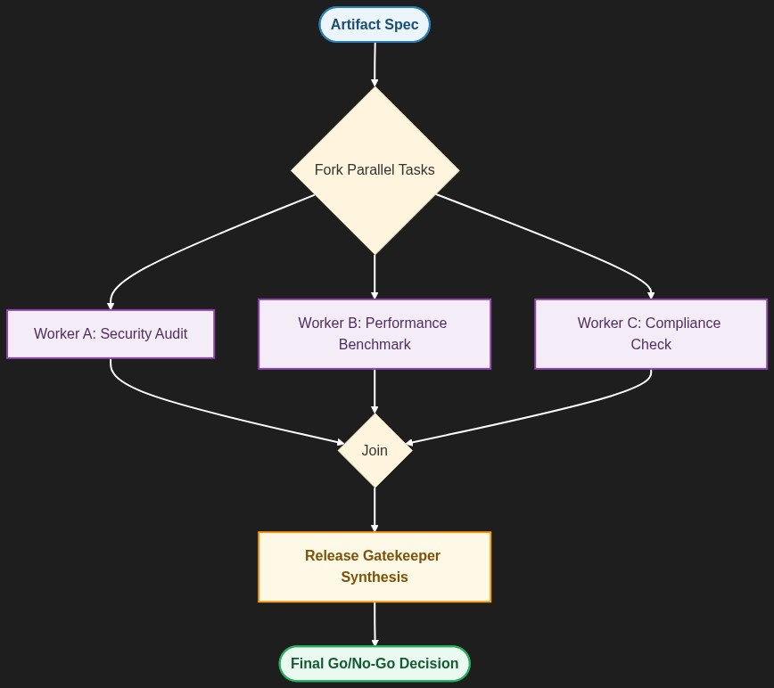

</div>

<details><summary>🔍 <b>View Mermaid Architecture Code</b></summary>

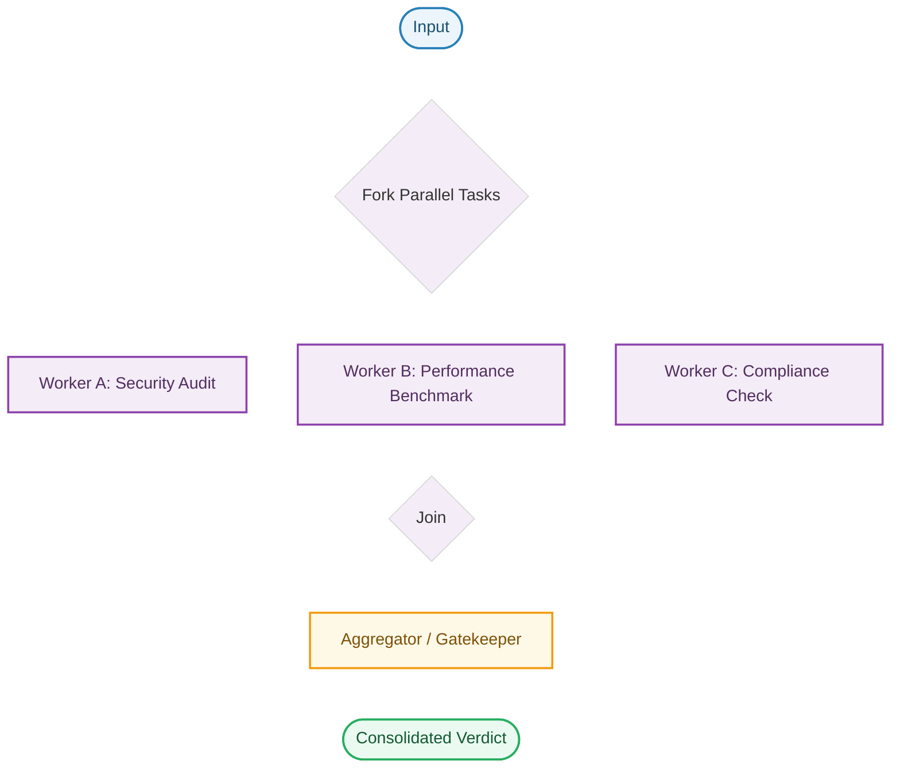
</details>

### 3. Semantic Routing
Classifies intent using structured output and directs control to the single most specialized domain handler.

<div align="center">

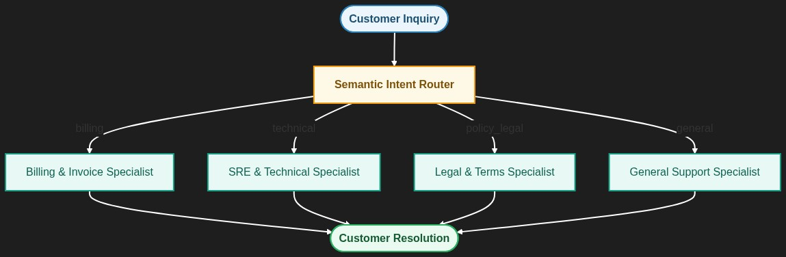

</div>

<details><summary>🔍 <b>View Mermaid Architecture Code</b></summary>

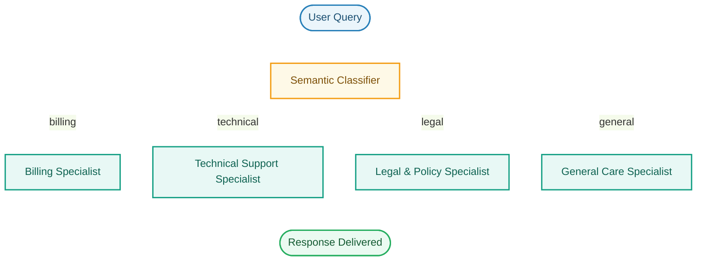
</details>

### 4. Orchestrator-Worker (Dynamic Map-Reduce)
A central planner breaks a complex problem into an arbitrary number of subtasks at runtime and dispatches them via LangGraph's `Send` API.

<div align="center">

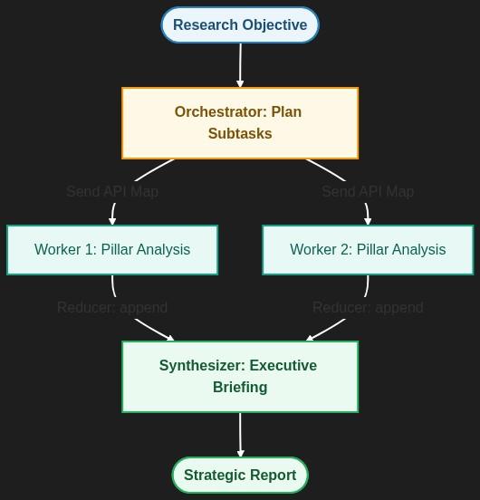

</div>

<details><summary>🔍 <b>View Mermaid Architecture Code</b></summary>

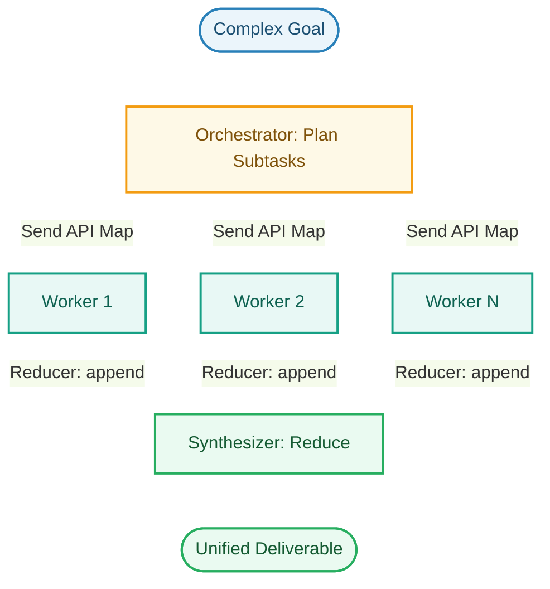
</details>

### 5. Evaluator-Optimizer Loop
Iteratively refines output until an objective rubric score threshold is met or maximum retries are exhausted.

<div align="center">

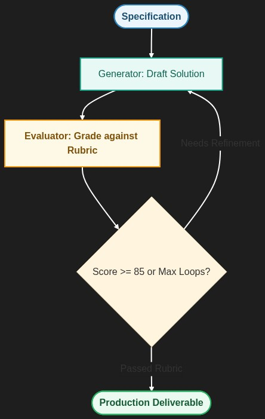

</div>

<details><summary>🔍 <b>View Mermaid Architecture Code</b></summary>

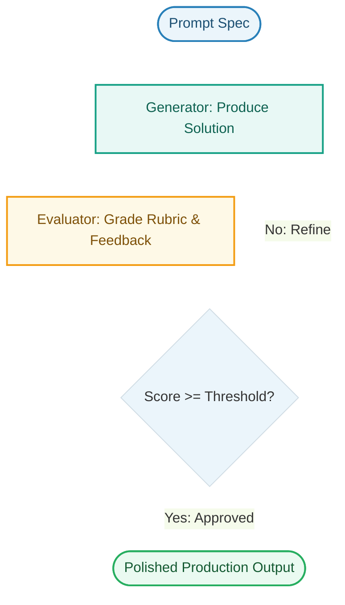
</details>

### 6. Human-in-the-Loop (HITL) Gate
Checkpointer persists state; `interrupt()` pauses execution before high-risk actions to require human review; `Command(resume=...)` injects human decisions.

<div align="center">


</div>

<details><summary>🔍 <b>View Mermaid Architecture Code</b></summary>

```mermaid
%%{init: {'theme': 'base', 'themeVariables': { 'lineColor': '#ffffff', 'primaryColor': '#FDEDEC'}}}%%
flowchart LR
    classDef startNode fill:#EBF5FB,stroke:#2980B9,stroke-width:2px,color:#1B4F72;
    classDef prepNode fill:#E8F8F5,stroke:#16A085,stroke-width:2px,color:#0E6251;
    classDef pauseNode fill:#FDEDEC,stroke:#E74C3C,stroke-width:3px,color:#78281F,font-weight:bold;
    classDef humanNode fill:#FEF9E7,stroke:#F39C12,stroke-width:2px,color:#7E5109;
    classDef execNode fill:#EAFAF1,stroke:#27AE60,stroke-width:2px,color:#145A32;

    START([Critical Change]):::startNode --> Prep[Agent: Plan & Assess Blast Radius]:::prepNode
    Prep --> Gate{Risk > Threshold?}
    
    Gate -->|Yes| Pause[interrupt: Halt Execution]:::pauseNode
    Pause -.->|Await Review| Human([Human Reviewer]):::humanNode
    Human -.->|Command resume: Approved| Resume[Resume Execution]:::execNode
    
    Gate -->|No| Exec[Auto-Apply]:::execNode
    Resume --> Exec
    Exec --> END([Audit Ledger Updated]):::execNode
    linkStyle default stroke:#ffffff,stroke-width:2px;
```
</details>

---

### 7. Composite Architecture (Enterprise Hybrid)
Combines multiple patterns into an end-to-end resilient pipeline: Semantic Routing -> Parallel Audits -> Evaluator Synthesis -> HITL Director Sign-Off.

<div align="center">

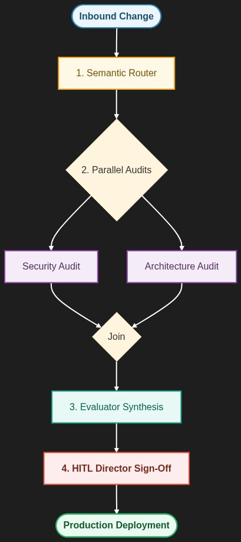

</div>

<details><summary>🔍 <b>View Mermaid Architecture Code</b></summary>

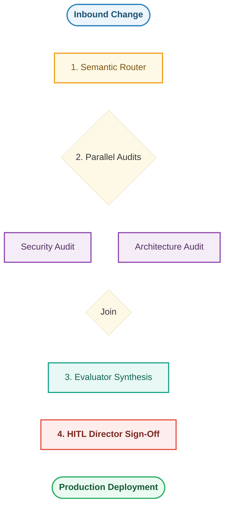
</details>

## 📊 Architectural Decision Matrix

| Workflow Pattern | Latency | Token Cost | Determinism | Best Suited Applications | Avoid When |
| :--- | :--- | :--- | :--- | :--- | :--- |
| **Prompt Chaining** | Medium (Linear) | Low | High | Step-by-step transformations, log postmortems, multi-stage summarization | Tasks that can be solved in a single prompt |
| **Parallelization** | Fast (Concurrent) | Medium | High | Independent multi-perspective checks, security/compliance audits, voting | Steps that have strict sequential dependencies |
| **Semantic Routing** | Low | Very Low | High | Triage, customer support ticket dispatching, multilingual queries | Highly ambiguous or hybrid requests needing multiple branches |
| **Orchestrator-Worker** | Medium to High | High | Medium | Open-domain research, dynamic map-reduce over unknown sub-tasks | Problems where sub-tasks are known statically ahead of time |
| **Evaluator-Optimizer** | High (Iterative) | High | High | Code generation, strict rubric scoring, mathematical reasoning | Latency-critical real-time chat APIs |
| **Human-in-the-Loop** | Asynchronous | Low | Absolute | High-value payments, destructive migrations, compliance approvals | High-frequency low-risk actions where human adds no value |
| **Composite Hybrid** | Variable | Medium-High | High | Enterprise mission-critical pipelines, release governance, triage-to-execution | Prototype or exploratory experiments |

---

## ⚙️ Centralized LLM Configuration & Resilience

All notebooks in this directory use the centralized `llm_config.py` located at the root of the workspace:

```python
from llm_config import get_llm, list_free_models

# Obtain resilient model with automatic fallback across free providers
llm = get_llm()
```

- **Configurable in `.env`**:
  ```env
  LLM_MODEL=openai/gpt-oss-120b
  LLM_TEMPERATURE=0.7
  LLM_ENABLE_FALLBACKS=True
  ```
- **Fallback Chain**: `openai/gpt-oss-120b` $\to$ `qwen/qwen3.8-27b` $\to$ `openai/gpt-oss-20b`.
- **Zero Rate-Limit Lockouts**: If a free tier limit is reached, subsequent calls automatically route to fallback models without breaking workflows.
