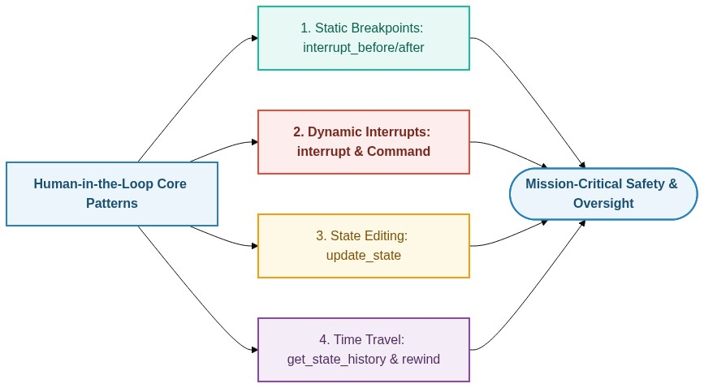
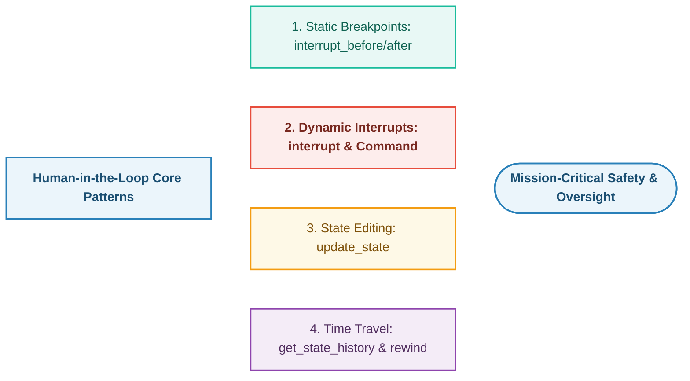
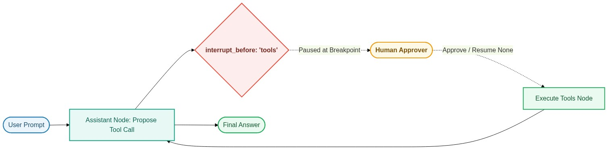
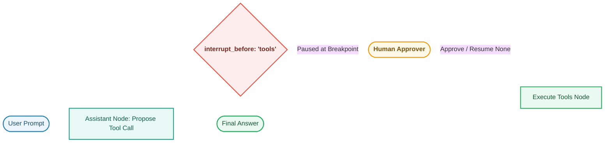
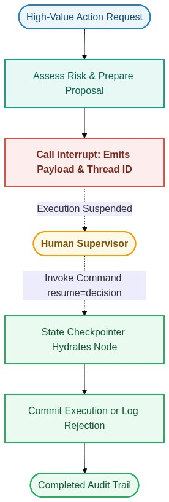
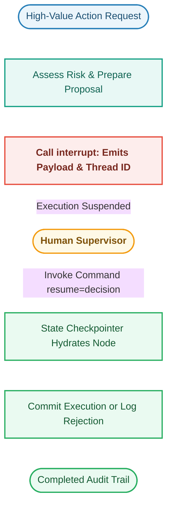
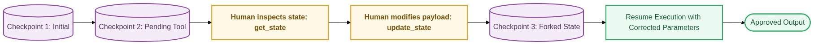
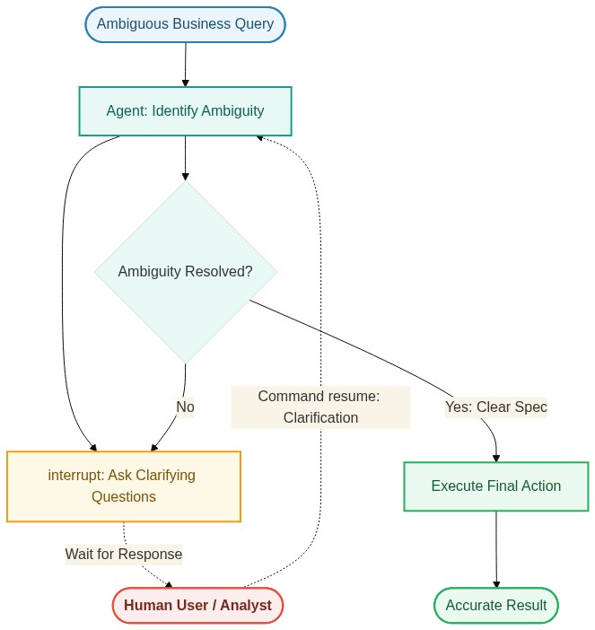
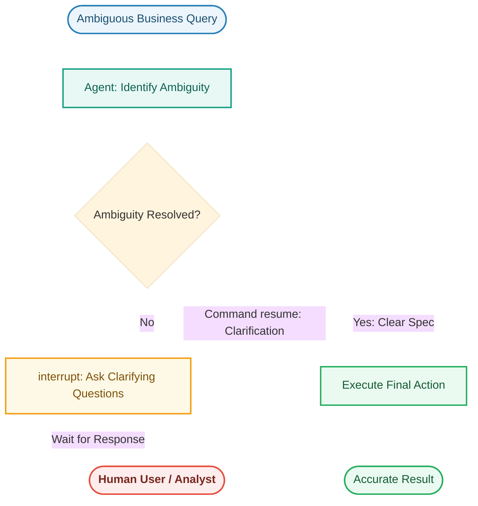

# 🛡️ Human-in-the-Loop (HITL) Architecture Guide

This directory provides a production-grade masterclass in **Human-in-the-Loop (HITL)** workflows built with **LangGraph**, **LangChain**, and high-performance open LLMs (via Groq with automatic multi-model fallback).

---

## 🧭 Why Human-in-the-Loop?

In mission-critical enterprise applications, full autonomy introduces unacceptable risk. **Human-in-the-Loop** patterns provide deterministic safety, compliance auditing, and parameter verification.

🔍 <b>View Mermaid Architecture Code</b>

---

## 📂 Notebook Catalog

| Notebook | Focus & Core Primitives | Production Use Case |
| :--- | :--- | :--- |
| **[`0-master_human_in_the_loop.ipynb`](file:///c:/RAG/Code/11-HumanintheLoop/0-master_human_in_the_loop.ipynb)** | **Masterclass Guide**: Breakpoints, Dynamic Interrupts, State Editing, and Time-Travel | Enterprise database migration gates, financial transaction overrides, and multi-turn compliance reviews. |
| **[`1-Humanintheloop.ipynb`](file:///c:/RAG/Code/11-HumanintheLoop/1-Humanintheloop.ipynb)** | **Foundational Guide**: Memory checkpointers, tool binding, state inspection, and streaming values | Step-by-step interactive agent debugging, streaming values, and tool call authorization. |

---

## 🎨 Visual Architecture of the HITL Patterns

### 1. Static Breakpoints (`interrupt_before=["tools"]`)
Halts execution automatically before entering designated nodes (e.g., irreversible tool actions).

🔍 <b>View Mermaid Architecture Code</b>

---

### 2. Dynamic In-Node Interrupts (`interrupt()` + `Command(resume=...)`)
Pauses execution dynamically *inside* arbitrary node code, yielding structured payloads and resuming with human decision objects.

🔍 <b>View Mermaid Architecture Code</b>

---

### 3. State Editing & Parameter Overrides (`update_state`)
Allows supervisors to inspect pending model decisions and overwrite tool arguments or message contents mid-flight.

```mermaid
%%{init: {'theme': 'base', 'themeVariables': {'lineColor': '#ffffff'}}}%%
flowchart LR
    classDef startNode fill:#EBF5FB,stroke:#2980B9,stroke-width:2px,color:#1B4F72;
    classDef snapNode fill:#F4ECF7,stroke:#8E44AD,stroke-width:2px,color:#512E5F;
    classDef editNode fill:#FEF9E7,stroke:#F39C12,stroke-width:2px,color:#7E5109,font-weight:bold;
    classDef execNode fill:#EAFAF1,stroke:#27AE60,stroke-width:2px,color:#145A32;

    S1[(Checkpoint 1: Initial)]:::snapNode --> S2[(Checkpoint 2: Pending Tool)]:::snapNode
    S2 --> Inspect[Human inspects state: get_state]:::editNode
    Inspect --> Override[Human modifies payload: update_state]:::editNode
    Override --> S3[(Checkpoint 3: Forked State)]:::snapNode
    S3 --> Resume[Resume Execution with Corrected Parameters]:::execNode
    Resume --> END([Approved Output]):::execNode
linkStyle default stroke:#ffffff,stroke-width:2px;
```

🔍 <b>View Mermaid Architecture Code</b>

---

### 4. Interactive Clarification & Disambiguation
Engages human analysts in multi-turn dialogues when ambiguous queries require domain clarification.

🔍 <b>View Mermaid Architecture Code</b>

---

## 📊 Comparison & Decision Guide

| Pattern | Control Granularity | State Changes Allowed? | Best Suited For |
| :--- | :--- | :--- | :--- |
| **Static Breakpoint** | Node boundary (`interrupt_before`) | Yes (via `update_state`) | Database writes, third-party API mutations, destructive commands |
| **Dynamic Interrupt** | Exact code line (`interrupt()`) | Yes (via `Command(resume=...)`) | Context-rich approval, risk evaluations, compliance gates |
| **State Editing** | Any message or tool argument | Yes | Fixing prompt typos, adjusting payout amounts, overriding models |
| **Time Travel** | Checkpoint snapshot history | Yes (can fork/replay past state) | Auditing, incident postmortems, reproducing model bugs |
