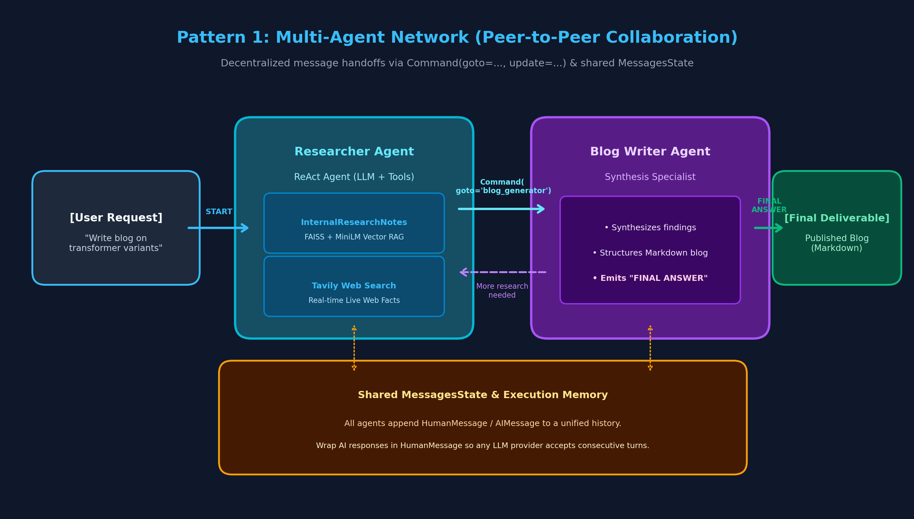
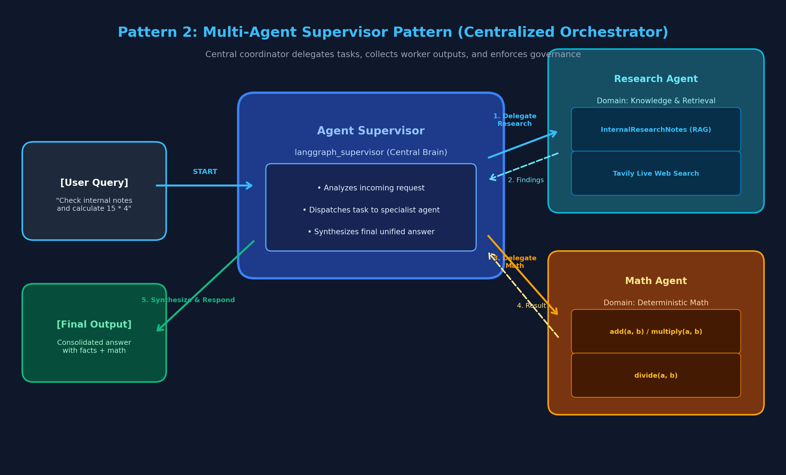
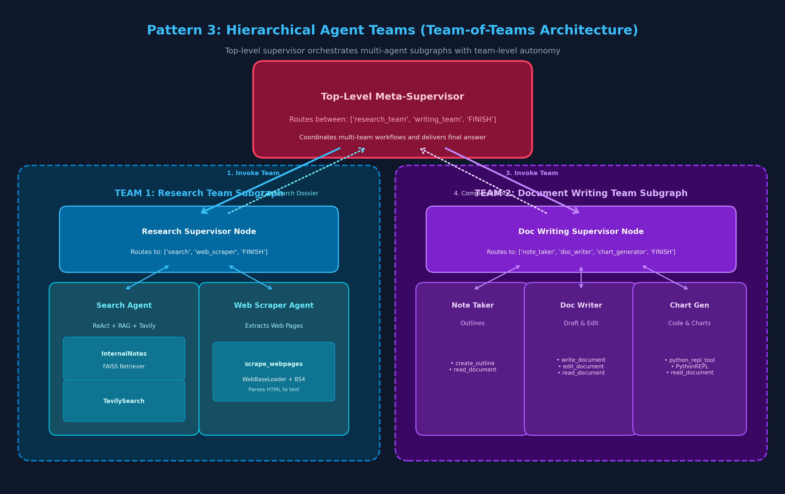

# 🤖 Module 13: Multi-Agent RAG Architectures

Welcome to **Module 13: Multi-Agent Retrieval-Augmented Generation (RAG)**. This module demonstrates how to transition from brittle single-agent RAG pipelines to resilient, collaborative multi-agent architectures using **LangGraph v0.3**, **FAISS Vector Retrieval**, and **Centralized LLMs**.

---

## 📚 Module Overview & Notebook Index

| Notebook | Pattern | Architecture Style | Primary Use Case |
| :--- | :--- | :--- | :--- |
| **[1-multiagent.ipynb](file:///c:/RAG/Code/13-MultiAgentRAG/1-multiagent.ipynb)** | Complete Reference | All 3 patterns in a single tutorial notebook | End-to-end monolithic reference & quick experiments |
| **[2-multi_agent_network.ipynb](file:///c:/RAG/Code/13-MultiAgentRAG/2-multi_agent_network.ipynb)** | **Pattern 1: Multi-Agent Network** | Decentralized Peer-to-Peer Mesh (`Command`) | Sequential co-creation (Researcher + Content Writer) |
| **[3-multi_agent_supervisor.ipynb](file:///c:/RAG/Code/13-MultiAgentRAG/3-multi_agent_supervisor.ipynb)** | **Pattern 2: Multi-Agent Supervisor** | Centralized Hub-and-Spoke (`langgraph-supervisor`) | Multi-domain routing (RAG Research + Arithmetic Math) |
| **[4-hierarchical_agent_teams.ipynb](file:///c:/RAG/Code/13-MultiAgentRAG/4-hierarchical_agent_teams.ipynb)** | **Pattern 3: Hierarchical Agent Teams** | Team-of-Teams Subgraphs (Meta-Supervisor) | Enterprise pipelines (Research Team + Doc Writing Team) |

---

## 🎨 Architecture Deep Dive

### Pattern 1: Multi-Agent Network (Peer-to-Peer Collaboration)
In a **Multi-Agent Network**, agents collaborate as equal peers without a centralized manager directing every single step. Control is passed dynamically between agents using LangGraph's `Command(goto=..., update=...)`.



- **Workflow:** `START -> researcher -> blog_generator -> [FINAL ANSWER ? END : researcher]`
- **Key Mechanism:** Each agent inspects the shared `MessagesState` and decides which colleague should act next.
- **Provider Safety:** AI message outputs are wrapped in `HumanMessage(content=..., name="<agent>")` so any LLM provider accepts consecutive turns without throwing alternating role exceptions.

---

### Pattern 2: Multi-Agent Supervisor Pattern (Centralized Orchestrator)
The **Agent Supervisor Pattern** introduces a central manager node that coordinates specialized worker agents. Instead of workers passing messages directly to one another, the **Supervisor Agent** controls all communication flow, task delegation, and final synthesis.



- **Workflow:** `User Query -> Supervisor -> [Delegates to Specialist 1 or 2] -> Handoff Back -> Final Synthesis -> User`
- **Key Mechanism:** Built using `langgraph_supervisor.create_supervisor` with `add_handoff_back_messages=True` and `output_mode="full_history"`.
- **Domain Specialists:**
  - **Research Agent:** Queries empirical vector store (`data/research_notes.txt`) and Tavily live search.
  - **Math Agent:** Uses deterministic arithmetic tools (`add`, `multiply`, `divide`).

---

### Pattern 3: Hierarchical Agent Teams (Team-of-Teams Architecture)
When an enterprise task grows in complexity or involves many specialized roles, a single supervisor becomes a bottleneck and suffers from context overload. **Hierarchical Agent Teams** solve this by decomposing the system into specialized, autonomous subgraphs (teams), each governed by its own mid-level team supervisor, all reporting to a top-level meta-supervisor.



- **Top-Level Meta-Supervisor:** Routes between `research_team` and `writing_team`.
- **Team 1: Research Team Subgraph:**
  - `Research Supervisor`: Routes between `search` and `web_scraper`.
  - `Search Agent`: Internal RAG retrieval + Tavily search.
  - `Web Scraper Agent`: Scrapes external URLs using `WebBaseLoader` and BeautifulSoup.
- **Team 2: Document Writing Team Subgraph:**
  - `Writing Supervisor`: Routes between `note_taker`, `doc_writer`, and `chart_generator`.
  - `Note Taker Agent`: Outlines documents (`create_outline`).
  - `Doc Writer Agent`: Drafts and refines sections (`write_document`, `edit_document`).
  - `Chart Generator Agent`: Sandboxed Python execution (`python_repl_tool`, `PythonREPL`).

---

## 📊 Comprehensive Pattern Comparison

| Feature | Pattern 1: Network | Pattern 2: Supervisor | Pattern 3: Hierarchical Teams |
| :--- | :--- | :--- | :--- |
| **Topology** | Peer-to-Peer Mesh / Ring | Centralized Hub-and-Spoke | Multi-Tier Tree (Team-of-Teams) |
| **Routing Logic** | Agents inspect state & handoff via `Command` | Supervisor LLM delegates tasks | Top-level LLM routes to compiled subgraphs |
| **Agent Autonomy** | High (each agent decides next step) | Medium (supervised by central router) | High inside teams; governed at top level |
| **Scalability** | 2–3 agents | 4–8 agents | 10–50+ agents (divided into subgraphs) |
| **Context Window Cost**| Shared linear history | History routed through supervisor | Isolated within team subgraphs; summarized at top |
| **Fault Tolerance** | If one agent loops, ring stalls | Supervisor can intercept errors & re-route | Subgraph errors isolated; does not crash whole system |
| **Code Tool Isolation** | Global | Global | Isolated within specific team worker nodes |
| **Best Used For** | Co-writing, code drafting + review | Multi-domain queries (RAG + Math) | Large enterprise dossiers, end-to-end report generation |

---

## 🛠️ Environment & Prerequisites

Ensure the following API keys are present in your workspace root `.env`:

```ini
# Core LLM API Key (Groq Free Tier)
GROQ_API_KEY=gsk_...

# Search API Key
TAVILY_API_KEY=tvly-dev-...

# Optional OpenAI Key
OPENAI_API_KEY=sk-...
```

All dependencies are defined in [requirment.txt](file:///c:/RAG/Code/requirment.txt):
- `langgraph`, `langgraph-supervisor`
- `langchain-core`, `langchain-community`, `langchain-experimental`
- `langchain-groq`, `langchain-tavily`, `tavily-python`
- `langchain-huggingface`, `sentence-transformers`, `faiss-cpu`
