# 🏛️ Comprehensive RAG & Agentic Design Patterns Guide (Folders 9 – 15)

> **Architectural Master Reference**: A complete, deep-dive theoretical and practical guide to all Retrieval-Augmented Generation (RAG) and Agentic Workflow design patterns implemented across Modules 9 through 15. Every pattern includes exhaustive natural-language theory, end-to-end dataflow mechanics, Mermaid diagrams, trade-off matrices, and direct links to corresponding Jupyter notebooks.

---

## 📑 Master Navigation & Table of Contents

1. [Executive Taxonomy & Comparative Matrix](#-executive-taxonomy--comparative-matrix)
2. [Folder 9: Agentic RAG Architecture Patterns](#-folder-9-agentic-rag-architecture-patterns)
   - [9.1 Pattern: ReAct (Reasoning + Acting) Agent](#91-pattern-react-reasoning--acting-agent)
   - [9.2 Pattern: Multi-Tool & Multi-Source ReAct Agent](#92-pattern-multi-tool--multi-source-react-agent)
   - [9.3 Pattern: Basic StateGraph Agentic RAG](#93-pattern-basic-stategraph-agentic-rag)
   - [9.4 Pattern: Decision-Maker RAG with Self-Correction](#94-pattern-decision-maker-rag-with-self-correction)
   - [9.5 Pattern: Token & Event Streaming Agent](#95-pattern-token--event-streaming-agent)
   - [9.6 Pattern: Modern Agent Architectures Taxonomy](#96-pattern-modern-agent-architectures-taxonomy)
3. [Folder 10: LangGraph Agentic Workflow Patterns](#-folder-10-langgraph-agentic-workflow-patterns)
   - [10.1 Pattern: Prompt Chaining (Sequential Pipelines)](#101-pattern-prompt-chaining-sequential-pipelines)
   - [10.2 Pattern: Parallelization (Sectioning & Guardrailing)](#102-pattern-parallelization-sectioning--guardrailing)
   - [10.3 Pattern: Semantic Intent Routing](#103-pattern-semantic-intent-routing)
   - [10.4 Pattern: Orchestrator-Worker (Dynamic Map-Reduce)](#104-pattern-orchestrator-worker-dynamic-map-reduce)
   - [10.5 Pattern: Evaluator-Optimizer (Iterative Refinement)](#105-pattern-evaluator-optimizer-iterative-refinement)
   - [10.6 Pattern: Human-in-the-Loop Approval Workflow](#106-pattern-human-in-the-loop-approval-workflow)
   - [10.7 Masterclass Workflow Compilation](#107-masterclass-workflow-compilation)
4. [Folder 11: Human-in-the-Loop (HITL) Safety & Oversight Patterns](#-folder-11-human-in-the-loop-hitl-safety--oversight-patterns)
   - [11.1 Pattern: Static Breakpoints (`interrupt_before` / `interrupt_after`)](#111-pattern-static-breakpoints-interrupt_before--interrupt_after)
   - [11.2 Pattern: Dynamic In-Node Interrupts (`interrupt()` + `Command(resume=...)`)](#112-pattern-dynamic-in-node-interrupts-interrupt--commandresume)
   - [11.3 Pattern: State Inspection & State Editing (`update_state`)](#113-pattern-state-inspection--state-editing-update_state)
   - [11.4 Pattern: Time Travel & Execution Branching (`get_state_history`)](#114-pattern-time-travel--execution-branching-get_state_history)
5. [Folder 12: Autonomous RAG Cognitive Loop Patterns](#-folder-12-autonomous-rag-cognitive-loop-patterns)
   - [12.1 Pattern: Chain-of-Thought (CoT) with Autonomous RAG](#121-pattern-chain-of-thought-cot-with-autonomous-rag)
   - [12.2 Pattern: Autonomous Self-Reflection & Critique (Actor-Critic)](#122-pattern-autonomous-self-reflection--critique-actor-critic)
   - [12.3 Pattern: Query Planning & Sub-Query Decomposition](#123-pattern-query-planning--sub-query-decomposition)
   - [12.4 Pattern: Iterative Retrieval & Gap Refinement](#124-pattern-iterative-retrieval--gap-refinement)
   - [12.5 Pattern: Multi-Source Context Answer Synthesis](#125-pattern-multi-source-context-answer-synthesis)
   - [12.6 Pattern: Full Autonomous Agentic RAG Cognitive Loop](#126-pattern-full-autonomous-agentic-rag-cognitive-loop)
6. [Folder 13: Multi-Agent RAG Collaboration Patterns](#-folder-13-multi-agent-rag-collaboration-patterns)
   - [13.1 Pattern: Multi-Agent Network (Decentralized Mesh)](#131-pattern-multi-agent-network-decentralized-mesh)
   - [13.2 Pattern: Multi-Agent Supervisor (Centralized Hub-and-Spoke)](#132-pattern-multi-agent-supervisor-centralized-hub-and-spoke)
   - [13.3 Pattern: Hierarchical Agent Teams (Team-of-Teams Subgraphs)](#133-pattern-hierarchical-agent-teams-team-of-teams-subgraphs)
   - [13.4 Unified Multi-Agent Architectural Reference](#134-unified-multi-agent-architectural-reference)
7. [Folder 14: Corrective RAG (CRAG) Pattern](#-folder-14-corrective-rag-crag-pattern)
   - [14.1 Pattern: Document Evaluation, Fallback Search & Query Transformation](#141-pattern-document-evaluation-fallback-search--query-transformation)
8. [Folder 15: Adaptive RAG Pattern](#-folder-15-adaptive-rag-pattern)
   - [15.1 Pattern: Query Analysis, Dynamic Routing & Dual-Stage Grounding Guards](#151-pattern-query-analysis-dynamic-routing--dual-stage-grounding-guards)
9. [Pattern Decision Framework: How to Choose the Right Architecture](#-pattern-decision-framework-how-to-choose-the-right-architecture)

---

## 📊 Executive Taxonomy & Comparative Matrix

The table below contrasts the 7 major paradigm groups across latency, token cost, autonomy level, and failure mitigation strategies:

| Folder / Module | Paradigm | Autonomy Level | Latency SLA | Error Recovery Mechanism | Primary Production Fit |
| :--- | :--- | :--- | :--- | :--- | :--- |
| **09 - Agentic RAG** | Tool-Calling ReAct & Router Agents | Medium to High | Variable (1–5 LLM calls) | Tool retry & query rewriting loops | Dynamic QA across heterogeneous APIs & docs |
| **10 - Workflows** | Structured Graph Orchestration | Low to Medium | Predictable (Bounded steps) | Conditional edges & validation nodes | Deterministic business logic, SLAs, compliance |
| **11 - Human in Loop** | Human Checkpointing & Gating | Governed (Supervised) | Human-Bounded | Human override, state edit & time-travel rewind | High-blast-radius ops (financial, SQL, infra) |
| **12 - Autonomous RAG** | Cognitive Loops & Self-Reflexion | High (Autonomous) | High (Multi-turn iterative loops) | Gap detection, self-critique, and re-retrieval | Complex analytical research, multi-part questions |
| **13 - Multi-Agent RAG** | Distributed Multi-Agent Systems | Very High (Collaborative) | High (Inter-agent communication) | Supervisor redirection, team isolation | Enterprise division of labor (Research + Writing) |
| **14 - Corrective RAG** | Retrieval Quality Evaluation (CRAG) | Medium (Gated Retrieval) | Moderate (2–3 LLM calls) | Tavily Web Search fallback when vector DB fails | Eliminating out-of-domain knowledge voids |
| **15 - Adaptive RAG** | Dynamic Routing + Dual Hallucination Guard | High (Adaptive) | Dynamic (1 call direct, 3–4 if routed) | Dual-stage guard: hallucination & answer graders | Universal customer-facing search & hybrid RAG |

---

## 🤖 Folder 9: Agentic RAG Architecture Patterns

Traditional RAG is purely passive: an incoming user query is embedded, cosine similarity pulls $K$ nearest chunks from a vector database, and an LLM generates a response in a single forward pass. **Agentic RAG** transforms this pipeline into an active cognitive system where the language model dynamically decides **if**, **when**, and **which** tools to invoke.

```
c:\RAG\Code\9-AgenticRAG\
├── 1-ReActAgents.ipynb
├── 2-MultiToolReAct.ipynb
├── 3-basic_agentic_rag.ipynb
├── 4-desion_maker_rag.ipynb
├── 5-streaming.ipynb
├── Agent_Architecture/
│   └── agent_architectures.ipynb
└── ReAct_LangGraph_Studio/
    ├── langgraph.json
    └── openai_agent.py
```

---

### 9.1 Pattern: ReAct (Reasoning + Acting) Agent

#### Natural Language Theory & Core Intuition
The **ReAct Pattern** (Yao et al., 2022) interleaves reasoning traces ("Thoughts") with task-specific actions ("Tool Calls") and observations ("Tool Outputs"). In standard prompting, language models frequently hallucinate facts or suffer from cascading reasoning errors. In pure tool-calling without reasoning, the model lacks tactical direction. ReAct solves this by enforcing an explicit cognitive loop:
1. **Thought**: The model generates a reasoning step analyzing its progress toward the goal.
2. **Action**: The model selects an external tool (e.g., ArXiv, Wikipedia, Python calculator) and generates typed arguments.
3. **Observation**: The execution environment returns the tool's output to the context window.
4. **Repetition**: The cycle repeats until the agent determines it has gathered sufficient evidence to output a final answer.

#### Architecture Flowchart (Mermaid)

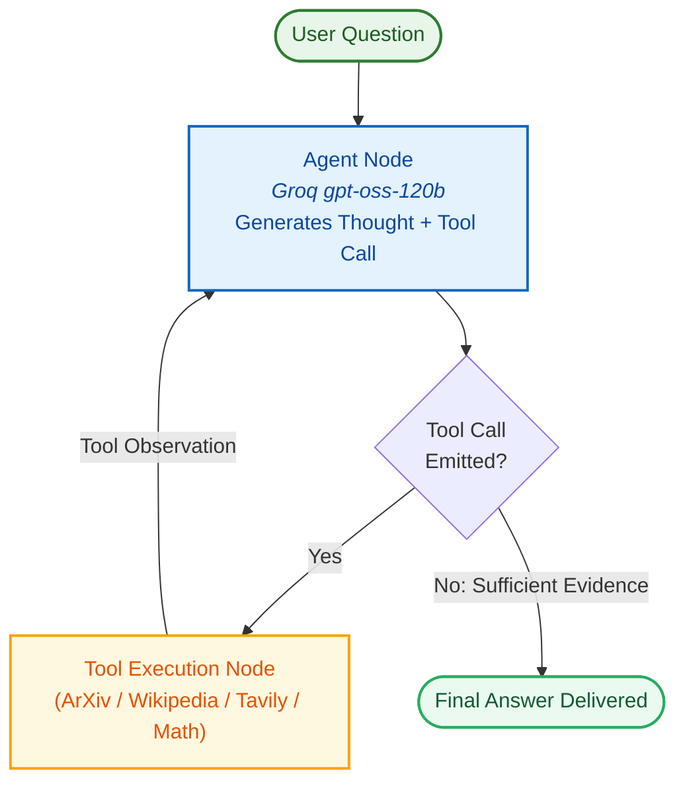

#### Notebook Reference
- Program: [`1-ReActAgents.ipynb`](file:///c:/RAG/Code/9-AgenticRAG/1-ReActAgents.ipynb)
- Key Tools: `ArxivQueryRun`, `WikipediaQueryRun`, `TavilySearchResults`, and deterministic arithmetic tools.

---

### 9.2 Pattern: Multi-Tool & Multi-Source ReAct Agent

#### Natural Language Theory & Core Intuition
While a basic ReAct agent uses a uniform tool catalog, real-world RAG demands connecting disparate modalities and authority domains:
- **Academic Rigor**: Querying ArXiv for peer-reviewed preprints.
- **Broad Semantic Knowledge**: Querying Wikipedia for general encyclopedic context.
- **Current Live Events**: Querying Tavily web search for breaking news.
- **Exact Math & Analytics**: Querying Python functions to prevent arithmetic hallucinations.

The **Multi-Tool ReAct Pattern** utilizes function schemas (via JSON Schema / Pydantic) bound to the LLM via `.bind_tools()`. The model evaluates tool descriptions to resolve ambiguities. For example, if asked *"What is the latest revenue of NVIDIA and what is its square root?"*, the model invokes `TavilySearch` for the financial data, followed by a local `sqrt` math tool for the exact computation.

#### Architecture Flowchart (Mermaid)

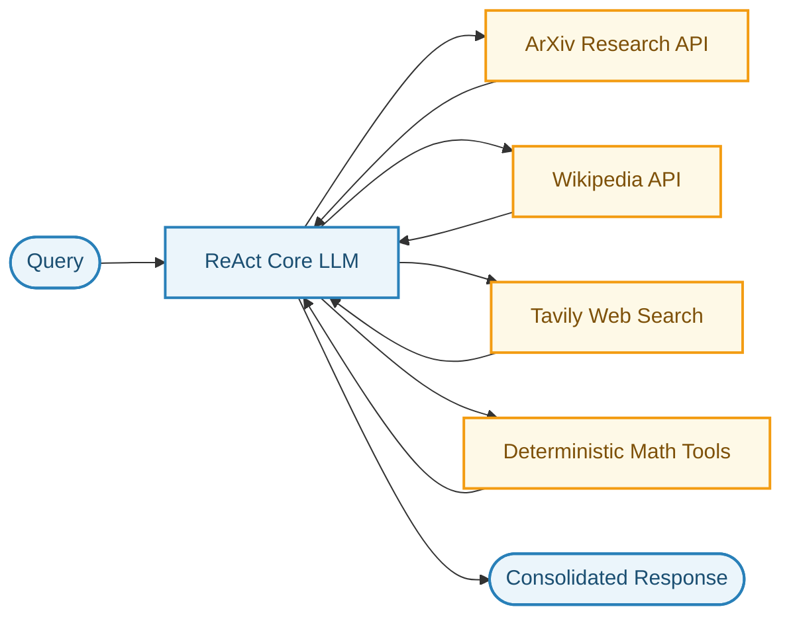

#### Notebook Reference
- Program: [`2-MultiToolReAct.ipynb`](file:///c:/RAG/Code/9-AgenticRAG/2-MultiToolReAct.ipynb)

---

### 9.3 Pattern: Basic StateGraph Agentic RAG

#### Natural Language Theory & Core Intuition
A major challenge with legacy chain abstractions (like `RetrievalQA`) is that application state is implicit, opaque, and hard to inspect. LangGraph introduces the **StateGraph Pattern**, where:
1. **Explicit Typed State**: A typed schema (`MessagesState` or custom `TypedDict`) stores the conversation history, user query, retrieved context chunks, and generation.
2. **Discrete Nodes**: Retrieval and generation are isolated into independent functions (`retriever` node and `responder` node).
3. **Deterministic Transitions**: Node execution is deterministic, auditable, and easily wrapped with telemetry or latency tracking.

This pattern forms the bedrock of production RAG architectures: it strips away monolithic black-box chains and replaces them with an explicit, observable directed graph.

#### Architecture Flowchart (Mermaid)

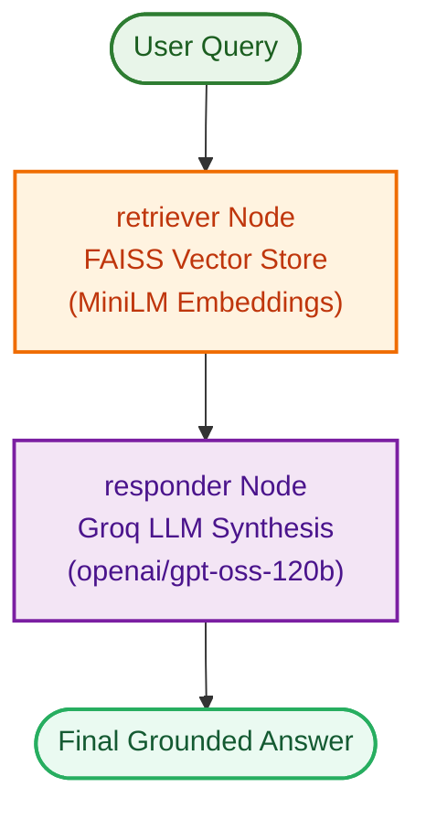

#### Notebook Reference
- Program: [`3-basic_agentic_rag.ipynb`](file:///c:/RAG/Code/9-AgenticRAG/3-basic_agentic_rag.ipynb)

---

### 9.4 Pattern: Decision-Maker RAG with Self-Correction

#### Natural Language Theory & Core Intuition
The **Decision-Maker RAG Pattern** replaces static retrieval with an intelligent triage and validation pipeline:
1. **Agent Router**: An LLM agent analyzes the input. If the question is generic chit-chat, it responds immediately without wasting vector search compute. If it pertains to specialized documentation, it invokes a targeted domain retriever.
2. **Relevance Grader (`grade_documents`)**: After retrieval, an LLM-as-a-judge evaluates each retrieved chunk against a binary rubric ("yes" = relevant, "no" = irrelevant).
3. **Query Reformulation Loop (`rewrite`)**: If the retrieved documents lack topical relevance, the graph routes to a query rewriter. The rewriter reformulates the user prompt into a semantically optimized query and routes back to the agent for a second retrieval attempt.
4. **Grounded Generation**: Only verified relevant documents are passed to the generator.

#### Architecture Flowchart (Mermaid)

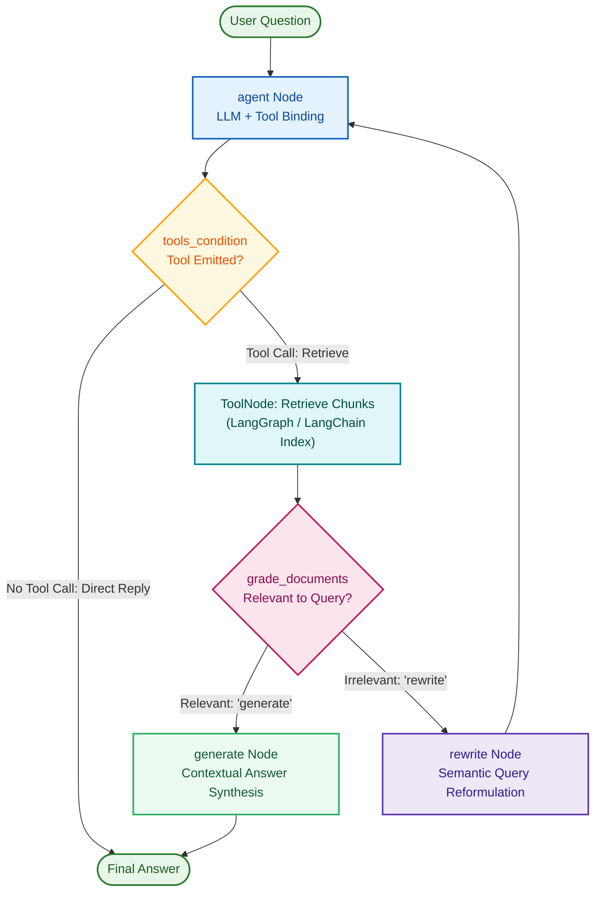

#### Notebook Reference
- Program: [`4-desion_maker_rag.ipynb`](file:///c:/RAG/Code/9-AgenticRAG/4-desion_maker_rag.ipynb)

---

### 9.5 Pattern: Token & Event Streaming Agent

#### Natural Language Theory & Core Intuition
In multi-step agentic RAG, cumulative latency can exceed 5–10 seconds because multiple LLM calls, tool executions, and re-ranking operations execute sequentially. If users see a blank screen while waiting, perceived latency is intolerable. The **Streaming Agent Pattern** leverages LangGraph's asynchronous event pipeline (`.astream()` and `.astream_events()`) to provide immediate feedback:
- **Token-Level Streaming**: As the synthesis LLM produces tokens, they are immediately piped to the UI client.
- **Node-Level Event Streaming**: The UI receives metadata indicating what the agent is doing in real time (e.g., *"Searching internal vector store..."*, *"Grading retrieved documents..."*, *"Synthesizing response..."*).

#### Notebook Reference
- Program: [`5-streaming.ipynb`](file:///c:/RAG/Code/9-AgenticRAG/5-streaming.ipynb)

---

### 9.6 Pattern: Modern Agent Architectures Taxonomy

#### Natural Language Theory & Core Intuition
AI systems operate on a spectrum of autonomy and control. As autonomy increases, flexibility rises, but determinism and predictability decrease. The catalog of patterns explores five core paradigms:
1. **Prompt Chaining**: Fixed, deterministic linear steps.
2. **ReAct**: Iterative thought-action-observation cycles.
3. **Plan-and-Execute**: Decoupling macroscopic roadmap generation from individual execution steps.
4. **Self-Reflection (Reflexion)**: Generating solutions, grading outputs against rubrics, and updating memory with critiques.
5. **Multi-Agent Supervisor**: Central manager delegating subtasks to specialized domain agents.

#### Architecture Taxonomy (Mermaid)

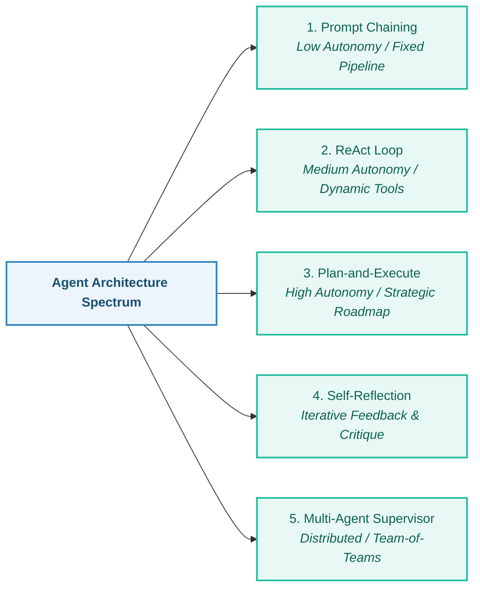

#### Notebook Reference
- Program: [`agent_architectures.ipynb`](file:///c:/RAG/Code/9-AgenticRAG/Agent_Architecture/agent_architectures.ipynb)
- Studio Deployable Agent: [`openai_agent.py`](file:///c:/RAG/Code/9-AgenticRAG/ReAct_LangGraph_Studio/openai_agent.py)

---

## 🌐 Folder 10: LangGraph Agentic Workflow Patterns

Why choose **Workflows** over completely autonomous agents? Unconstrained autonomous agents run in open-ended loops, generating variable latency, unpredictable token burn, and non-deterministic behavior. **Agentic Workflows** enforce a well-defined graph topology, guaranteeing:
- **Predictable SLAs**: Graphs terminate in bounded steps.
- **Cost Efficiency**: No runaway reasoning loops.
- **Observability**: Clear state transitions for compliance and debugging.

```
c:\RAG\Code\10-Workflows\
├── 0-master_agentic_workflows.ipynb
├── 1-prompting_chaining.ipynb
├── 2-parallelization.ipynb
├── 3-Routing.ipynb
├── 4-orchestrator-worker.ipynb
├── 5-Evaluator-optimizer.ipynb
├── 6-human_in_the_loop_workflow.ipynb
└── README.md
```

---

### 10.1 Pattern: Prompt Chaining (Sequential Pipelines)

#### Natural Language Theory & Core Intuition
Prompt Chaining decomposes an intricate task into a deterministic sequence of discrete LLM processing steps, where the output of step $N$ serves as the input to step $N+1$.
- **Why it matters**: Asking an LLM to simultaneously extract facts, analyze implications, check legal compliance, and format markdown in a single giant prompt leads to degraded attention and hallucinated omissions.
- **How it works**:
  - `Step 1 (Extract)`: Extracts core facts, technical specifications, and metrics.
  - `Step 2 (Analyze)`: Synthesizes implications and identifies strategic trade-offs.
  - `Step 3 (Format)`: Converts the synthesized analysis into a polished corporate deliverable.

#### Architecture Flowchart (Mermaid)

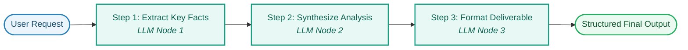

#### Notebook Reference
- Program: [`1-prompting_chaining.ipynb`](file:///c:/RAG/Code/10-Workflows/1-prompting_chaining.ipynb)

---

### 10.2 Pattern: Parallelization (Sectioning & Guardrailing)

#### Natural Language Theory & Core Intuition
When tasks consist of independent subproblems, sequential execution introduces unnecessary latency. The **Parallelization Pattern** forks execution across multiple nodes concurrently and aggregates their results:
1. **Sectioning**: Splitting a document or report into independent chapters (e.g., Executive Summary, Financial Analysis, Technical Architecture), generating each simultaneously, and joining them.
2. **Voting & Guardrailing**: Running multiple independent evaluations on a user query concurrently (e.g., a Security & Injection Guard, a Hate/Toxicity Guard, and a Domain Policy Guard). If any guard fails, the query is blocked before it reaches expensive downstream generators.

#### Architecture Flowchart (Mermaid)

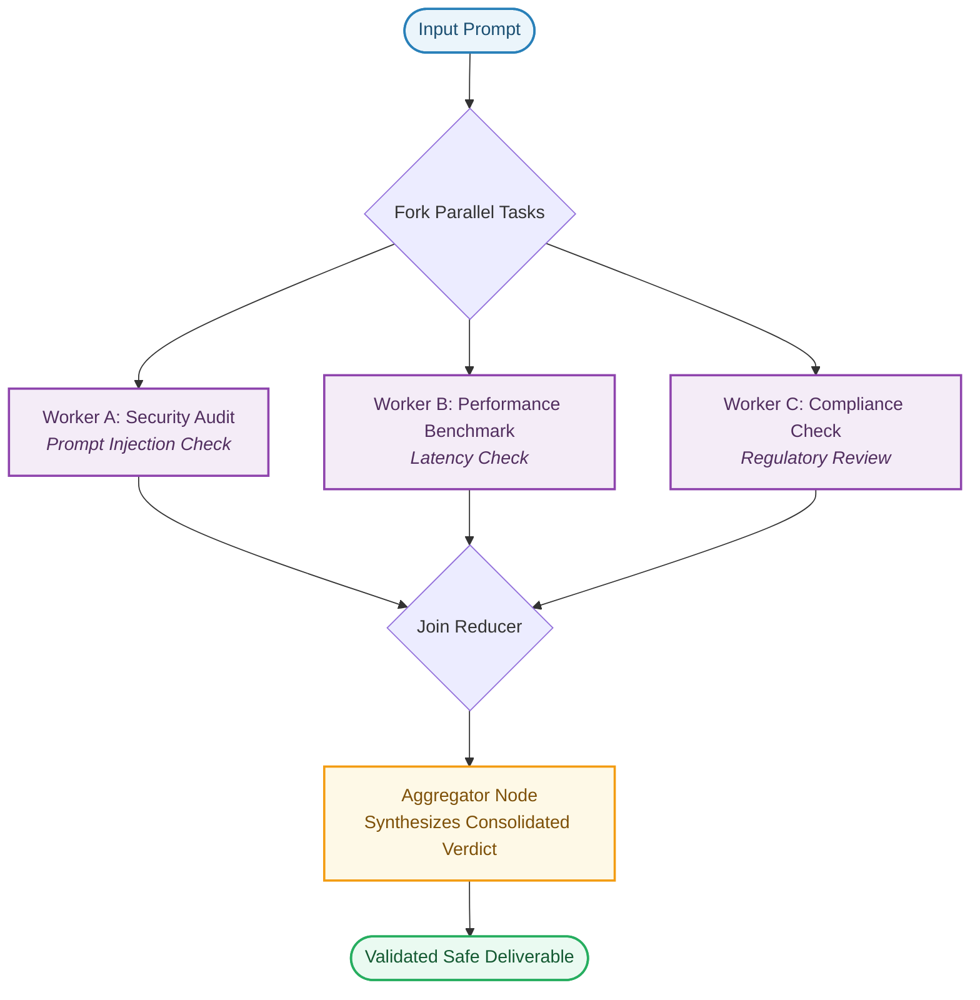

#### Notebook Reference
- Program: [`2-parallelization.ipynb`](file:///c:/RAG/Code/10-Workflows/2-parallelization.ipynb)

---

### 10.3 Pattern: Semantic Intent Routing

#### Natural Language Theory & Core Intuition
Not all inputs require the same processing pipeline. Treating a simple invoice request and a complex debugging stack trace with the same monolithic agent is wasteful. The **Semantic Routing Pattern**:
1. Uses structured classification (via Pydantic schema or constrained LLM output) to classify incoming intents into discrete categories (e.g., `billing`, `technical_support`, `legal`, `general_care`).
2. Conditional edges in LangGraph route execution directly to the designated specialist node without executing unnecessary steps.

#### Architecture Flowchart (Mermaid)

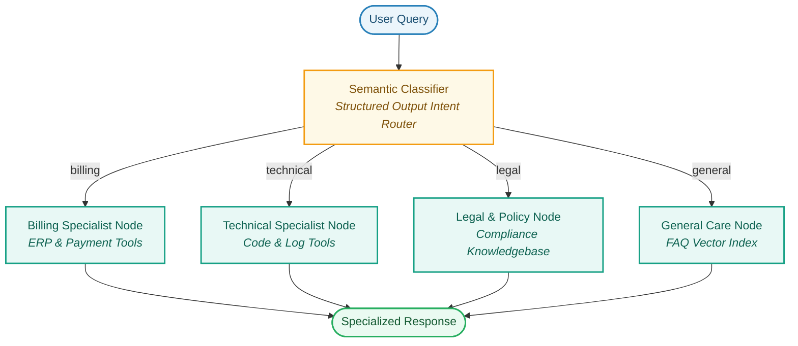

#### Notebook Reference
- Program: [`3-Routing.ipynb`](file:///c:/RAG/Code/10-Workflows/3-Routing.ipynb)

---

### 10.4 Pattern: Orchestrator-Worker (Dynamic Map-Reduce)

#### Natural Language Theory & Core Intuition
Static parallelization requires hardcoding the worker branches in advance. However, real-world tasks have arbitrary, dynamic scopes (e.g., *"Analyze these 5 different contracts"* vs *"Analyze these 2 contracts"*). The **Orchestrator-Worker Pattern** implements dynamic map-reduce using LangGraph's `Send` API:
1. **Orchestrator**: A planning LLM analyzes the goal and outputs an arbitrary list of subtasks.
2. **Dynamic Map (`Send`)**: For every subtask in the generated plan, LangGraph dispatches an independent worker node instance in parallel.
3. **Reducer Aggregator**: Worker outputs append to a shared list via an `operator.add` reducer, and a final synthesizer consolidates the findings.

#### Architecture Flowchart (Mermaid)

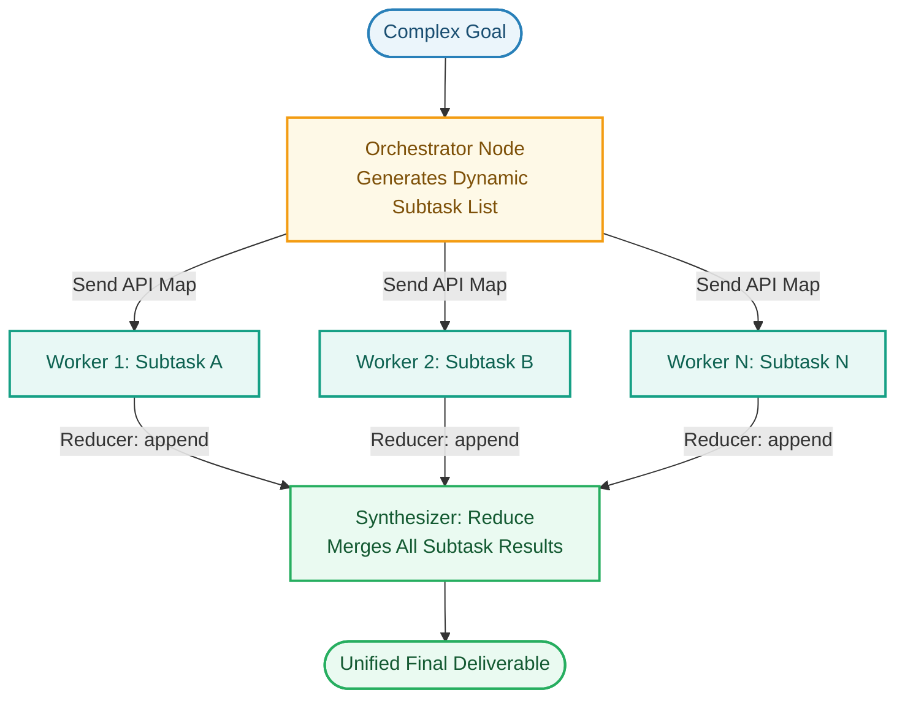

#### Notebook Reference
- Program: [`4-orchestrator-worker.ipynb`](file:///c:/RAG/Code/10-Workflows/4-orchestrator-worker.ipynb)

---

### 10.5 Pattern: Evaluator-Optimizer (Iterative Refinement)

#### Natural Language Theory & Core Intuition
First-pass LLM generations rarely meet strict production standards. The **Evaluator-Optimizer Pattern** creates an automated feedback loop:
1. **Generator Node**: Drafts a solution based on the user prompt and prior critique history.
2. **Evaluator Node**: Acts as an objective judge, grading the draft against a defined rubric (e.g., correctness, tone, code formatting, security) and producing structured scores and corrective instructions.
3. **Loop Condition**: If `score >= threshold` or `attempts >= max_iterations`, execution exits to approval; otherwise, the draft and critique loop back to the Generator for targeted refinement.

#### Architecture Flowchart (Mermaid)

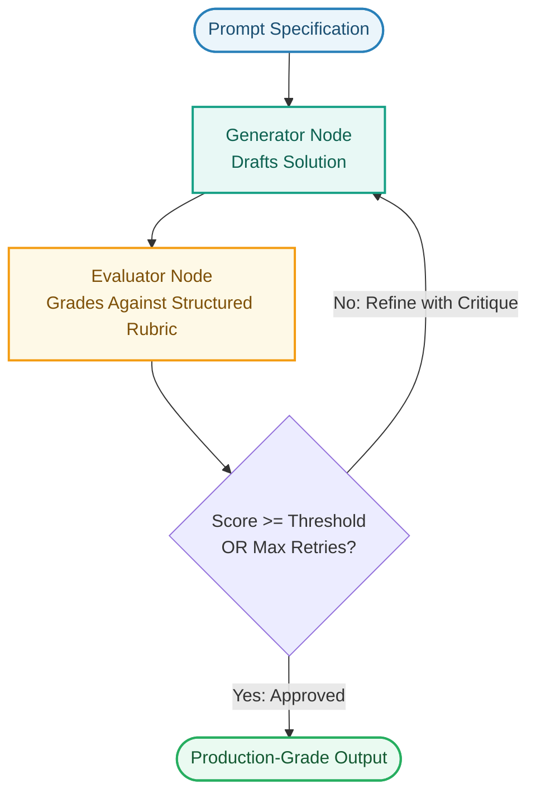

#### Notebook Reference
- Program: [`5-Evaluator-optimizer.ipynb`](file:///c:/RAG/Code/10-Workflows/5-Evaluator-optimizer.ipynb)

---

### 10.6 Pattern: Human-in-the-Loop Approval Workflow

#### Natural Language Theory & Core Intuition
Automated systems should not execute critical actions (e.g., dropping database tables, transferring funds, publishing code) without explicit authorization. The workflow uses LangGraph's `MemorySaver` checkpointer and `interrupt()` primitive to pause execution, persist state to disk/memory, present the proposed action to a human reviewer, and resume only upon receiving an explicit signed decision via `Command(resume=...)`.

#### Architecture Flowchart (Mermaid)


#### Notebook Reference
- Program: [`6-human_in_the_loop_workflow.ipynb`](file:///c:/RAG/Code/10-Workflows/6-human_in_the_loop_workflow.ipynb)

---

### 10.7 Masterclass Workflow Compilation

#### Natural Language Theory & Core Intuition
The masterclass notebook synthesizes all six core workflow patterns into a single cohesive runtime, demonstrating how real-world architectures chain patterns together:
- A user query enters a **Semantic Router**,
- Broad research triggers an **Orchestrator-Worker** dynamic map-reduce,
- Subtasks pass through an **Evaluator-Optimizer** loop,
- And final deployment requires a **Human-in-the-Loop** checkpoint gate.

#### Notebook Reference
- Program: [`0-master_agentic_workflows.ipynb`](file:///c:/RAG/Code/10-Workflows/0-master_agentic_workflows.ipynb)

---

## 🛡️ Folder 11: Human-in-the-Loop (HITL) Safety & Oversight Patterns

In enterprise applications, full autonomy introduces legal, financial, and operational hazards. **Human-in-the-Loop (HITL)** patterns establish deterministic safety mechanisms using LangGraph checkpointers (e.g., `MemorySaver`, Postgres checkpointer) to pause, inspect, modify, and replay execution graphs.

```
c:\RAG\Code\11-HumanintheLoop\
├── 0-Humanintheloop.ipynb
├── 1-master_human_in_the_loop.ipynb
├── README.md
└── diagrams/
```

---

### 11.1 Pattern: Static Breakpoints (`interrupt_before` / `interrupt_after`)

#### Natural Language Theory & Core Intuition
Static breakpoints are declared at compile time via `graph.compile(checkpointer=memory, interrupt_before=["tools"])`:
- Before the graph executes any node listed in `interrupt_before`, execution automatically suspends.
- The state checkpoint captures the exact tool name and parameters generated by the LLM.
- An administrator inspects the pending call. Calling `graph.invoke(None, thread_config)` approves the call and resumes execution.

#### Architecture Flowchart (Mermaid)

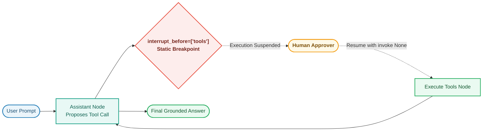

#### Notebook Reference
- Programs: [`1-master_human_in_the_loop.ipynb`](file:///c:/RAG/Code/11-HumanintheLoop/1-master_human_in_the_loop.ipynb), [`0-Humanintheloop.ipynb`](file:///c:/RAG/Code/11-HumanintheLoop/0-Humanintheloop.ipynb)

---

### 11.2 Pattern: Dynamic In-Node Interrupts (`interrupt()` + `Command(resume=...)`)

#### Natural Language Theory & Core Intuition
Unlike static breakpoints that blindly halt before a node, **Dynamic Interrupts** pause execution from *inside* arbitrary node code using the `interrupt(payload)` function:
- **Condition-Driven**: The node inspects runtime parameters (e.g., if `transaction_amount > $10,000` or `sql_query.contains("DROP")`). If harmless, it executes silently; if hazardous, it calls `interrupt()`.
- **Payload Delivery**: `interrupt({"action": "wire_transfer", "amount": 50000})` bubbles up structured context directly to the supervisor's user interface.
- **Resumption with Data**: The supervisor responds via `graph.invoke(Command(resume={"approved": True, "reviewer": "Alice"}), config)`. The `interrupt()` call returns that exact payload inside the resumed node.

#### Architecture Flowchart (Mermaid)

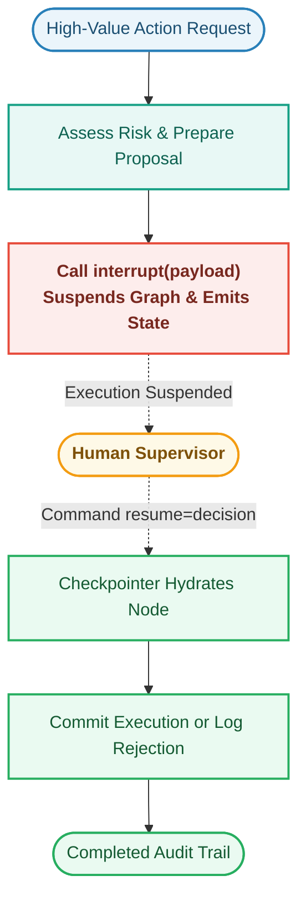

#### Notebook Reference
- Programs: [`1-master_human_in_the_loop.ipynb`](file:///c:/RAG/Code/11-HumanintheLoop/1-master_human_in_the_loop.ipynb), [`0-Humanintheloop.ipynb`](file:///c:/RAG/Code/11-HumanintheLoop/0-Humanintheloop.ipynb)

---

### 11.3 Pattern: State Inspection & State Editing (`update_state`)

#### Natural Language Theory & Core Intuition
When an LLM prepares a tool call with a subtle bug (e.g., targeting the wrong database ID or generating a slightly malformed query), rejecting and regenerating the entire chain is slow and wasteful. **State Editing** allows humans to surgically modify the graph's state:
- The human inspects pending state via `graph.get_state(config)`.
- The human edits the tool call arguments via `graph.update_state(config, {"messages": [edited_tool_call]})`.
- When resumed, the graph executes the human-edited arguments instead of the model's original draft.

---

### 11.4 Pattern: Time Travel & Execution Branching (`get_state_history`)

#### Natural Language Theory & Core Intuition
Every checkpoint saved by the checkpointer is immutable and timestamped. LangGraph allows developers to iterate over history via `graph.get_state_history(config)`:
- **Auditability**: Review every single thought, tool call, and state transition in order.
- **Replay & Time Travel**: By extracting a historical `checkpoint_id`, you can resume execution from 5 steps earlier, providing alternative prompts or corrected facts to fork execution down an alternate path.

#### Notebook Reference
- Program: [`1-master_human_in_the_loop.ipynb`](file:///c:/RAG/Code/11-HumanintheLoop/1-master_human_in_the_loop.ipynb)

---

## 🧠 Folder 12: Autonomous RAG Cognitive Loop Patterns

Standard RAG architectures assume retrieval is a one-shot process. However, real-world questions are frequently ambiguous, multi-faceted, or require synthesizing multiple pieces of evidence. **Autonomous RAG** equips pipelines with cognitive reasoning loops: query decomposition, self-reflection, sufficiency evaluation, and gap-driven iterative retrieval.

```
c:\RAG\Code\12-AutonomousRAG\
├── 0-Autonomousrag.pdf
├── 1-chain_of_thoughts_with_rag.ipynb
├── 2-self_reflection.ipynb
├── 3-query_planner_and_decomposition.ipynb
├── 4-iterative_retrieval.ipynb
├── 7-answersynthesis.ipynb
└── 8-autonomous_agentic_rag.ipynb
```

---

### 12.1 Pattern: Chain-of-Thought (CoT) with Autonomous RAG

#### Natural Language Theory & Core Intuition
When a user asks a complex question (e.g., *"How do vector embeddings in MiniLM differ from CLIP, and which is better for cross-modal search?"*), passing the raw question to a single vector query produces muddy semantic similarity scores. **Chain-of-Thought RAG**:
1. Uses a cognitive planning node to break down the problem into sequential reasoning milestones.
2. Formulates precise sub-inquiries for each milestone.
3. Retrieves isolated context chunks per step to prevent semantic dilution.
4. Integrates the reasoning path and retrieved evidence into a coherent multi-step answer.

#### Architecture Flowchart (Mermaid)

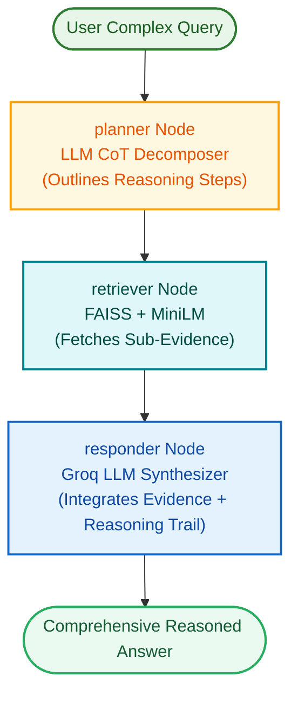

#### Notebook Reference
- Program: [`1-chain_of_thoughts_with_rag.ipynb`](file:///c:/RAG/Code/12-AutonomousRAG/1-chain_of_thoughts_with_rag.ipynb)

---

### 12.2 Pattern: Autonomous Self-Reflection & Critique (Actor-Critic)

#### Natural Language Theory & Core Intuition
Language models are prone to generating answers that sound persuasive but are subtly ungrounded in the retrieved text. **Self-Reflection RAG** introduces an internal Actor-Critic feedback loop:
1. **Actor (Generator)**: Generates a draft answer using the retrieved context.
2. **Critic (Reflector)**: Evaluates the draft against the retrieved context:
   - Does the answer make claims not found in the documents? (Hallucination check)
   - Did the answer omit key aspects of the user's question? (Completeness check)
3. **Autonomous Revision**: If the Critic detects factual gaps and `attempts < 2`, it signals a revision loop that re-queries the vector store with an expanded query and refines the draft.

#### Architecture Flowchart (Mermaid)

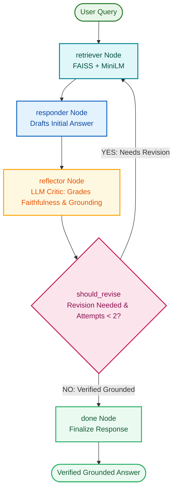

#### Notebook Reference
- Program: [`2-self_reflection.ipynb`](file:///c:/RAG/Code/12-AutonomousRAG/2-self_reflection.ipynb)

---

### 12.3 Pattern: Query Planning & Sub-Query Decomposition

#### Natural Language Theory & Core Intuition
Embedding multi-faceted questions into a single dense vector averages out keyword significance, often matching none of the subtopics effectively. **Query Decomposition**:
1. An LLM planner extracts the sub-intents into independent atomic queries.
2. Executes parallel retrieval across the vector index for each sub-question.
3. Consolidates the union of retrieved documents into an aggregated context window for unified synthesis.

#### Notebook Reference
- Program: [`3-query_planner_and_decomposition.ipynb`](file:///c:/RAG/Code/12-AutonomousRAG/3-query_planner_and_decomposition.ipynb)

---

### 12.4 Pattern: Iterative Retrieval & Gap Refinement

#### Natural Language Theory & Core Intuition
Initial vector retrieval frequently fails to pull sufficient depth for deep questions. The **Iterative Retrieval Pattern** checks context sufficiency after generation:
- If factual gaps remain, the model analyzes *what specific information is missing*.
- It synthesizes a targeted follow-up query (`refine_query` node) and performs a second retrieval pass before delivering the verified answer.

#### Notebook Reference
- Program: [`4-iterative_retrieval.ipynb`](file:///c:/RAG/Code/12-AutonomousRAG/4-iterative_retrieval.ipynb)

---

### 12.5 Pattern: Multi-Source Context Answer Synthesis

#### Natural Language Theory & Core Intuition
Production enterprise knowledge is fragmented across local documentation, public repositories, and academic publications. Multi-Source Answer Synthesis:
1. Queries multiple tools in parallel (Local FAISS index, ArXiv, Wikipedia).
2. Filters out noise and contradictions via an evaluation node.
3. Synthesizes a unified response featuring explicit inline citations.

#### Notebook Reference
- Program: [`7-answersynthesis.ipynb`](file:///c:/RAG/Code/12-AutonomousRAG/7-answersynthesis.ipynb)

---

### 12.6 Pattern: Full Autonomous Agentic RAG Cognitive Loop

#### Natural Language Theory & Core Intuition
The master architecture combines the outer planning loop, inner ReAct tool retrieval loop, iterative sufficiency check, and self-reflection quality gate into a complete autonomous system.

#### Architecture Flowchart (Mermaid)

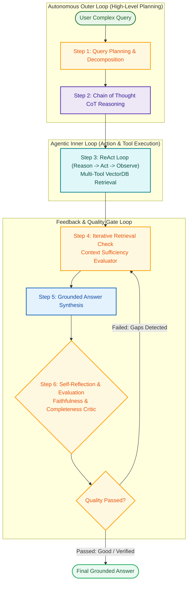

#### Notebook Reference
- Program: [`8-autonomous_agentic_rag.ipynb`](file:///c:/RAG/Code/12-AutonomousRAG/8-autonomous_agentic_rag.ipynb)

---

## 👥 Folder 13: Multi-Agent RAG Collaboration Patterns

When enterprise workflows expand to dozens of data sources, tools, and output formats, a single agent's context window becomes overloaded with tool schemas and conversational history. **Multi-Agent RAG** enforces separation of concerns by splitting duties across specialized, collaborating agents.

```
c:\RAG\Code\13-MultiAgentRAG\
├── 0-Multiagent+RAG.pdf
├── 1-multiagent.ipynb
├── 2-multi_agent_network.ipynb
├── 3-multi_agent_supervisor.ipynb
├── 4-hierarchical_agent_teams.ipynb
├── README.md
└── images/
```

---

### 13.1 Pattern: Multi-Agent Network (Decentralized Mesh)

#### Natural Language Theory & Core Intuition
In a **Multi-Agent Network**, agents collaborate as equal peers without a centralized manager directing every single step. Control is passed dynamically between agents using LangGraph's `Command(goto=..., update=...)`.
- **Peer-to-Peer Handoff**: The `researcher` agent pulls facts from the vector store and passes state to the `blog_generator` agent. If the writer notices missing technical citations, it passes control back to the `researcher`.
- **Role Isolation**: The research agent only carries research tools; the writer agent only carries formatting/markdown tools.
- **Provider Safety**: Agent outputs are wrapped in `HumanMessage(content=..., name="<agent_name>")` to prevent LLM provider exceptions regarding alternating roles.

#### Architecture Flowchart (Mermaid)

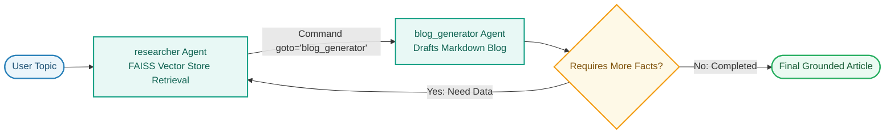

#### Notebook Reference
- Program: [`2-multi_agent_network.ipynb`](file:///c:/RAG/Code/13-MultiAgentRAG/2-multi_agent_network.ipynb)

---

### 13.2 Pattern: Multi-Agent Supervisor (Centralized Hub-and-Spoke)

#### Natural Language Theory & Core Intuition
As the number of agents grows beyond 3, peer-to-peer meshes can suffer from deadlocks or looping. The **Agent Supervisor Pattern** introduces a central manager node that coordinates specialized worker agents:
- Built using `langgraph_supervisor.create_supervisor`.
- The Supervisor acts as a decision-maker that evaluates the user prompt and delegates to domain workers:
  - **Research Agent**: Queries vector stores and Tavily search.
  - **Math Agent**: Executes exact Python calculations.
- Workers do not communicate directly; they return their results to the Supervisor, which either delegates to another specialist or synthesizes the final response.

#### Architecture Flowchart (Mermaid)

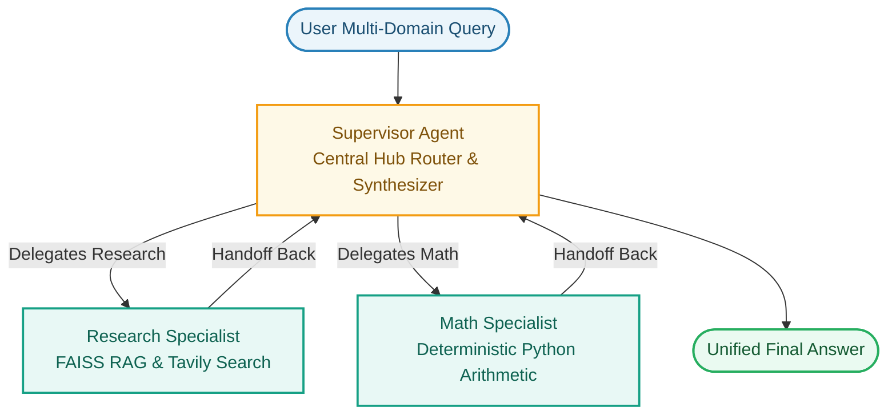

#### Notebook Reference
- Program: [`3-multi_agent_supervisor.ipynb`](file:///c:/RAG/Code/13-MultiAgentRAG/3-multi_agent_supervisor.ipynb)

---

### 13.3 Pattern: Hierarchical Agent Teams (Team-of-Teams Subgraphs)

#### Natural Language Theory & Core Intuition
When building end-to-end autonomous organizations (e.g., automated market research firms or software dev studios), a single supervisor becomes an operational bottleneck and context window limit. **Hierarchical Agent Teams** solve this by compiling entire multi-agent clusters into self-contained subgraphs:
- **Top-Level Meta-Supervisor**: Delegates between high-level teams (`Research Team` vs `Writing Team`).
- **Research Team Subgraph**: Has its own internal team supervisor orchestrating a `Search Agent` and a `Web Scraper Agent`.
- **Document Writing Team Subgraph**: Has an internal writing supervisor orchestrating a `Note Taker Agent`, a `Doc Writer Agent`, and a `Chart Generator Agent` (sandboxed Python REPL).

#### Architecture Flowchart (Mermaid)

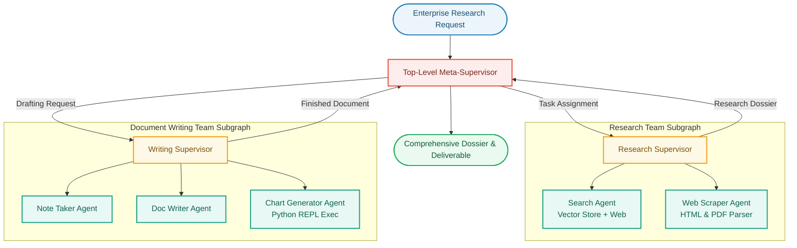

#### Notebook Reference
- Program: [`4-hierarchical_agent_teams.ipynb`](file:///c:/RAG/Code/13-MultiAgentRAG/4-hierarchical_agent_teams.ipynb)
- Master Reference: [`1-multiagent.ipynb`](file:///c:/RAG/Code/13-MultiAgentRAG/1-multiagent.ipynb)

---

## 🔍 Folder 14: Corrective RAG (CRAG) Pattern

```
c:\RAG\Code\14-CorrectiveRAG\
├── 37.1-Corrective+RAGs.pdf
└── corrective_rag.ipynb
```

---

### 14.1 Pattern: Document Evaluation, Fallback Search & Query Transformation

#### Natural Language Theory & Core Intuition
A critical flaw of standard RAG is its blind trust in retrieved documents. If a vector store returns irrelevant chunks (due to semantic drift or out-of-domain queries), passing them to the generator produces hallucinations. **Corrective RAG (CRAG)** introduces an automated self-correction and external fallback mechanism:
1. **Retrieve**: Pulls candidate documents from the local FAISS index.
2. **Relevance Grader**: An LLM-as-a-judge assesses each retrieved chunk's relevance to the question.
3. **Decide Branch**:
   - **Correct**: If all documents are relevant, proceed directly to generator synthesis.
   - **Incorrect / Ambiguous**: If documents are irrelevant, CRAG activates a corrective pathway:
     - **Transform Query**: The query is reformulated to extract core search entities.
     - **Web Search Fallback**: Tavily web search is queried to retrieve real-time external context.
4. **Generate**: Synthesizes the final answer using the filtered local context and/or supplementary web results.

#### Architecture Flowchart (Mermaid)

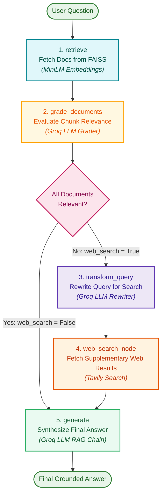

#### Notebook Reference
- Program: [`corrective_rag.ipynb`](file:///c:/RAG/Code/14-CorrectiveRAG/corrective_rag.ipynb)

---

## ⚡ Folder 15: Adaptive RAG Pattern

```
c:\RAG\Code\15-AdaptiveRAG\
├── 35-39-RAGS+(1).pdf
├── adaptive_rag.ipynb
└── adaptive_rag.py
```

---

### 15.1 Pattern: Query Analysis, Dynamic Routing & Dual-Stage Grounding Guards

#### Natural Language Theory & Core Intuition
**Adaptive RAG** represents the pinnacle of single-graph RAG architectures. Rather than treating all queries identically, it dynamically adapts the pipeline strategy to query complexity and validates outputs with dual post-generation quality gates:

1. **Query Analysis & Adaptive Routing**:
   - The query router evaluates the user prompt:
     - **Domain-Specific**: Routed to the local FAISS vector store.
     - **Broad / External / Real-Time**: Routed directly to Tavily web search.
2. **Document Relevance Filtering**:
   - Retrieved chunks are graded. If no documents are relevant, the pipeline reformulates the query and retries retrieval.
3. **Generation**:
   - Synthesizes a candidate answer based on verified context.
4. **Dual-Stage Post-Generation Verification**:
   - **Stage 1 (Hallucination Grader)**: An LLM judge evaluates whether the generated answer is strictly supported by the retrieved facts. If hallucinated, the graph loops back to re-generate.
   - **Stage 2 (Answer Grader)**: An LLM judge evaluates whether the generated answer directly resolves the user's initial question. If the answer is unhelpful or dodges the question, it triggers query transformation to retrieve better context.

#### Architecture Flowchart (Mermaid)

```mermaid
flowchart TD
    Start([User Question]) --> Router{"Question Router<br/><i>Groq LLM</i>"}
    
    Router -->|vectorstore| Retrieve["1. retrieve<br/>FAISS Vector Store<br/><i>(MiniLM Embeddings)</i>"]
    Router -->|web_search| WebSearch["Web Search<br/>Tavily Search Engine"]
    
    Retrieve --> GradeDocs["2. grade_documents<br/>Filter Relevant Chunks"]
    
    GradeDocs --> DocDecision{"Any Docs<br/>Relevant?"}
    DocDecision -->|Yes| Generate["3. generate<br/>Synthesize Candidate Answer"]
    DocDecision -->|No: All Irrelevant| TransformQuery["4. transform_query<br/>Semantic Reformulation"]
    
    TransformQuery --> Retrieve
    WebSearch --> Generate
    
    Generate --> HallucinationGrader{"Hallucination Grader<br/>Grounded in Docs?"}
    HallucinationGrader -->|No: Hallucinated| Generate
    HallucinationGrader -->|Yes: Grounded| AnswerGrader{"Answer Grader<br/>Resolves User Query?"}
    
    AnswerGrader -->|Yes: Useful| End([END: Final Grounded Answer])
    AnswerGrader -->|No: Not Useful| TransformQuery
    
    classDef startNode fill:#E8F5E9,stroke:#2E7D32,stroke-width:2px,color:#1B5E20;
    classDef routerNode fill:#FEF9E7,stroke:#F39C12,stroke-width:2px,color:#7E5109;
    classDef retNode fill:#E0F7FA,stroke:#00838F,stroke-width:2px,color:#004D40;
    classDef gradeNode fill:#FFF8E1,stroke:#FFA000,stroke-width:2px,color:#E65100;
    classDef genNode fill:#E3F2FD,stroke:#1565C0,stroke-width:2px,color:#0D47A1;
    classDef guardNode fill:#FCE4EC,stroke:#C2185B,stroke-width:2px,color:#880E4F;
    classDef endNode fill:#EAFAF1,stroke:#27AE60,stroke-width:2px,color:#145A32;
    class Start startNode;
    class Router,DocDecision routerNode;
    class Retrieve,WebSearch retNode;
    class GradeDocs,TransformQuery gradeNode;
    class Generate genNode;
    class HallucinationGrader,AnswerGrader guardNode;
    class End endNode;
```

#### Notebook Reference
- Program: [`adaptive_rag.ipynb`](file:///c:/RAG/Code/15-AdaptiveRAG/adaptive_rag.ipynb)
- Production Script: [`adaptive_rag.py`](file:///c:/RAG/Code/15-AdaptiveRAG/adaptive_rag.py)

---

## 🧭 Pattern Decision Framework: How to Choose the Right Architecture

Use this decision tree to identify the optimal design pattern for your target production use case:

```mermaid
flowchart TD
    Q1{"Is the task fixed & deterministic<br/>or does it require dynamic tool decisions?"}
    
    Q1 -->|Fixed & Predictable Steps| Workflows["Choose <b>Folder 10: Workflows</b><br/>(Prompt Chaining, Parallelization, Routing)"]
    Q1 -->|Dynamic Tool & Data Selection| Q2{"Are there high-risk, irreversible operations<br/>(Payments, SQL Drops, Infra)?"}
    
    Q2 -->|Yes: Strict Safety Required| HITL["Choose <b>Folder 11: Human-in-the-Loop</b><br/>(Static Breakpoints, interrupt & update_state)"]
    Q2 -->|No: Fully Autonomous Execution| Q3{"How many distinct domain roles<br/>or tools are required?"}
    
    Q3 -->|Single Domain / Few Tools| Q4{"Does internal vector retrieval frequently suffer<br/>from out-of-domain voids or hallucinations?"}
    Q3 -->|Multiple Distinct Teams & Roles| MultiAgent["Choose <b>Folder 13: Multi-Agent RAG</b><br/>(Network, Supervisor, Hierarchical Teams)"]
    
    Q4 -->|Frequent Retrieval Voids| CRAG["Choose <b>Folder 14: Corrective RAG (CRAG)</b><br/>(Doc Grader + Tavily Web Fallback)"]
    Q4 -->|Variable Query Types & Risk of Hallucinations| Adaptive["Choose <b>Folder 15: Adaptive RAG</b><br/>(Dynamic Route + Dual Hallucination/Answer Guards)"]
    Q4 -->|Complex Analytical Multi-Step Inquiries| AutoRAG["Choose <b>Folder 12: Autonomous RAG</b><br/>(Decomposition, CoT, Self-Reflection)"]
    Q4 -->|Standard Heterogeneous Tool QA| AgenticRAG["Choose <b>Folder 9: Agentic RAG</b><br/>(ReAct, MultiTool, Decision-Maker RAG)"]
    
    classDef decNode fill:#FEF9E7,stroke:#F39C12,stroke-width:2px,color:#7E5109;
    classDef targetNode fill:#E8F8F5,stroke:#1ABC9C,stroke-width:2px,color:#0E6251;
    class Q1,Q2,Q3,Q4 decNode;
    class Workflows,HITL,MultiAgent,CRAG,Adaptive,AutoRAG,AgenticRAG targetNode;
```

---

## 🔗 Consolidated Notebook Index (Folders 9 – 15)

| Folder | Notebook / Code File | Design Pattern |
| :--- | :--- | :--- |
| **09 - Agentic RAG** | [`1-ReActAgents.ipynb`](file:///c:/RAG/Code/9-AgenticRAG/1-ReActAgents.ipynb) | Basic ReAct Agent with Tool Use |
| **09 - Agentic RAG** | [`2-MultiToolReAct.ipynb`](file:///c:/RAG/Code/9-AgenticRAG/2-MultiToolReAct.ipynb) | Multi-Tool & Multi-Source ReAct Loop |
| **09 - Agentic RAG** | [`3-basic_agentic_rag.ipynb`](file:///c:/RAG/Code/9-AgenticRAG/3-basic_agentic_rag.ipynb) | Basic StateGraph RAG Architecture |
| **09 - Agentic RAG** | [`4-desion_maker_rag.ipynb`](file:///c:/RAG/Code/9-AgenticRAG/4-desion_maker_rag.ipynb) | Decision-Maker RAG with Self-Correction |
| **09 - Agentic RAG** | [`5-streaming.ipynb`](file:///c:/RAG/Code/9-AgenticRAG/5-streaming.ipynb) | Token & Event Streaming RAG Agent |
| **09 - Agentic RAG** | [`agent_architectures.ipynb`](file:///c:/RAG/Code/9-AgenticRAG/Agent_Architecture/agent_architectures.ipynb) | Modern Agent Architecture Taxonomy |
| **09 - Agentic RAG** | [`openai_agent.py`](file:///c:/RAG/Code/9-AgenticRAG/ReAct_LangGraph_Studio/openai_agent.py) | LangGraph Studio ReAct App |
| **10 - Workflows** | [`0-master_agentic_workflows.ipynb`](file:///c:/RAG/Code/10-Workflows/0-master_agentic_workflows.ipynb) | Masterclass: All 7 Workflow Patterns |
| **10 - Workflows** | [`1-prompting_chaining.ipynb`](file:///c:/RAG/Code/10-Workflows/1-prompting_chaining.ipynb) | Prompt Chaining (Sequential Pipeline) |
| **10 - Workflows** | [`2-parallelization.ipynb`](file:///c:/RAG/Code/10-Workflows/2-parallelization.ipynb) | Parallelization (Sectioning & Guardrailing) |
| **10 - Workflows** | [`3-Routing.ipynb`](file:///c:/RAG/Code/10-Workflows/3-Routing.ipynb) | Semantic Intent Routing |
| **10 - Workflows** | [`4-orchestrator-worker.ipynb`](file:///c:/RAG/Code/10-Workflows/4-orchestrator-worker.ipynb) | Orchestrator-Worker (Dynamic Map-Reduce) |
| **10 - Workflows** | [`5-Evaluator-optimizer.ipynb`](file:///c:/RAG/Code/10-Workflows/5-Evaluator-optimizer.ipynb) | Evaluator-Optimizer (Iterative Feedback) |
| **10 - Workflows** | [`6-human_in_the_loop_workflow.ipynb`](file:///c:/RAG/Code/10-Workflows/6-human_in_the_loop_workflow.ipynb) | Human-in-the-Loop Gating Workflow |
| **11 - Human in Loop** | [`1-master_human_in_the_loop.ipynb`](file:///c:/RAG/Code/11-HumanintheLoop/1-master_human_in_the_loop.ipynb) | Masterclass: Breakpoints, Dynamic Interrupts, State Edits |
| **11 - Human in Loop** | [`0-Humanintheloop.ipynb`](file:///c:/RAG/Code/11-HumanintheLoop/0-Humanintheloop.ipynb) | Interactive HITL Checkpointing & Streaming Lab |
| **12 - Autonomous RAG** | [`1-chain_of_thoughts_with_rag.ipynb`](file:///c:/RAG/Code/12-AutonomousRAG/1-chain_of_thoughts_with_rag.ipynb) | Chain-of-Thought (CoT) with Autonomous RAG |
| **12 - Autonomous RAG** | [`2-self_reflection.ipynb`](file:///c:/RAG/Code/12-AutonomousRAG/2-self_reflection.ipynb) | Autonomous Self-Reflection & Critique (Actor-Critic) |
| **12 - Autonomous RAG** | [`3-query_planner_and_decomposition.ipynb`](file:///c:/RAG/Code/12-AutonomousRAG/3-query_planner_and_decomposition.ipynb) | Query Planning & Sub-Query Decomposition |
| **12 - Autonomous RAG** | [`4-iterative_retrieval.ipynb`](file:///c:/RAG/Code/12-AutonomousRAG/4-iterative_retrieval.ipynb) | Iterative Retrieval & Gap-Driven Refinement |
| **12 - Autonomous RAG** | [`7-answersynthesis.ipynb`](file:///c:/RAG/Code/12-AutonomousRAG/7-answersynthesis.ipynb) | Multi-Source Context Answer Synthesis & Attribution |
| **12 - Autonomous RAG** | [`8-autonomous_agentic_rag.ipynb`](file:///c:/RAG/Code/12-AutonomousRAG/8-autonomous_agentic_rag.ipynb) | Full Autonomous Agentic RAG Cognitive Loop |
| **13 - Multi-Agent RAG** | [`1-multiagent.ipynb`](file:///c:/RAG/Code/13-MultiAgentRAG/1-multiagent.ipynb) | Monolithic Reference Guide for Multi-Agent Architectures |
| **13 - Multi-Agent RAG** | [`2-multi_agent_network.ipynb`](file:///c:/RAG/Code/13-MultiAgentRAG/2-multi_agent_network.ipynb) | Multi-Agent Network (Peer-to-Peer Mesh) |
| **13 - Multi-Agent RAG** | [`3-multi_agent_supervisor.ipynb`](file:///c:/RAG/Code/13-MultiAgentRAG/3-multi_agent_supervisor.ipynb) | Multi-Agent Supervisor (Centralized Hub-and-Spoke) |
| **13 - Multi-Agent RAG** | [`4-hierarchical_agent_teams.ipynb`](file:///c:/RAG/Code/13-MultiAgentRAG/4-hierarchical_agent_teams.ipynb) | Hierarchical Agent Teams (Team-of-Teams Subgraphs) |
| **14 - Corrective RAG** | [`corrective_rag.ipynb`](file:///c:/RAG/Code/14-CorrectiveRAG/corrective_rag.ipynb) | Corrective RAG (CRAG) with Tavily Fallback Search |
| **15 - Adaptive RAG** | [`adaptive_rag.ipynb`](file:///c:/RAG/Code/15-AdaptiveRAG/adaptive_rag.ipynb) | Adaptive RAG with Dual-Stage Grounding Guards |
| **15 - Adaptive RAG** | [`adaptive_rag.py`](file:///c:/RAG/Code/15-AdaptiveRAG/adaptive_rag.py) | Standalone Python Script for Adaptive RAG Pipeline |
