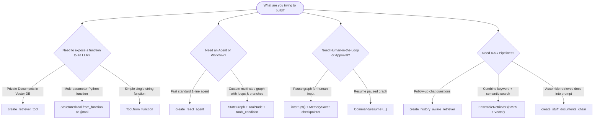

# 🛠️ AI Agents & RAG: Tools & Functions Guide

A complete, beginner-friendly cheatsheet and interview preparation guide for the core functions, tools, and classes used across this repository.

---

## 📌 Master Reference Table

Here is the quick-reference table explaining each function in **plain, simple language**: what it is, what problem it solves, and what you achieve by using it.

| Function / Component Name | Plain English Description (What is it? What can you achieve?) | Category |
| :--- | :--- | :--- |
| **`create_retriever_tool`** | Turns a private document search engine (retriever) into a callable "skill" for an AI agent. The agent can read its description and decide on its own when to search your company docs versus answering directly. | Tool Creation |
| **`StructuredTool.from_function`** | Packages any Python function that takes **multiple arguments** (like numbers, dates, or filters) into a tool for an LLM. It checks that the LLM sends the right data types before running the code. | Tool Creation |
| **`Tool` / `Tool.from_function`** | The simplest way to wrap a basic Python function that only takes **a single text string** into an AI tool. Perfect for quick one-input actions like a search bar or basic calculator. | Tool Creation |
| **`@tool`** | A Python decorator you put on top of any regular function to instantly turn it into an AI tool. Your function's docstring automatically becomes the instruction manual telling the LLM when to use it. | Tool Creation |
| **`ToolNode`** | The "hands" of a LangGraph agent. When the brain (LLM) says *"I need to run the search tool with query X"*, `ToolNode` actually executes the tool and hands the result back to the LLM. | Agent Execution |
| **`create_react_agent`** | A quick one-line factory that builds a fully working **Reason + Act (ReAct)** agent. It connects an LLM and a list of tools so the agent can think, call tools, inspect results, and answer in a loop. | Agent Creation |
| **`StateGraph`** | A blueprint builder for custom AI workflows. You define the steps (nodes) and the rules to move between steps (edges), allowing loops, branching decisions, and state tracking. | Workflow / Graph |
| **`tools_condition`** | A smart traffic-light router. It checks the LLM's response: if the LLM requested a tool, it routes the conversation to `ToolNode`; if the LLM is done and answered the user, it finishes the conversation. | Graph Routing |
| **`add_messages`** | A list manager for chat history. Instead of replacing old messages with new ones, it safely appends new messages and updates existing ones if their IDs match. | State Management |
| **`MessagesState`** | A ready-made template for a chat workflow's memory. It comes pre-configured with a message list and the `add_messages` rule so you don't have to write state boilerplate. | State Management |
| **`START` / `END`** | The universal "Enter" and "Exit" signs in LangGraph. `START` tells the system which node to run first, and `END` marks where the workflow terminates and delivers the final result. | Graph Routing |
| **`Command`** | A two-in-one remote control inside a node. It allows a step to update the graph's memory AND tell the system which node to jump to next in a single return statement. | Workflow Control |
| **`Send`** | The "fan-out" dispatcher. It lets you take a big task, split it into 5 or 10 smaller pieces, and send them to run in parallel on multiple worker nodes at the same time (map-reduce pattern). | Parallel Workflows |
| **`interrupt()`** | The "Pause Button" for AI. It temporarily stops graph execution and waits for a human to review, approve, or provide missing information before resuming. | Human-in-the-Loop |
| **`MemorySaver`** | An in-memory save-game recorder (checkpointer). It preserves the state of a conversation across multiple user turns and threads so the agent remembers what was said earlier. | Memory & Persistence |
| **`create_history_aware_retriever`** | A conversational question re-writer. If a user asks a follow-up like *"Tell me more about his second job"*, this rewrites it into *"What was Steve Jobs' second job at NeXT?"* so the vector search finds the right answer. | RAG Pipeline |
| **`create_stuff_documents_chain`** | A document gatherer. It takes all the text chunks retrieved from a database, "stuffs" them neatly into a single prompt template, and sends them to the LLM to write the final answer. | RAG Pipeline |
| **`create_retrieval_chain`** | The complete end-to-end RAG conveyor belt. It automatically links the retriever and the answer-generation chain together: User asks $\rightarrow$ retriever fetches docs $\rightarrow$ LLM writes response. | RAG Pipeline |
| **`EnsembleRetriever`** | A hybrid search blender. It runs both exact keyword search (BM25) and conceptual semantic search (Vector DB) together, ranks the combined results, and gives you the best of both worlds. | Advanced Retrieval |
| **`BM25Retriever`** | An exact keyword search engine. Unlike vector search, it excels at finding exact product serial numbers, error codes, SKUs, and rare technical names. | Advanced Retrieval |
| **`TavilySearchResults`** | A real-time web search tool built specifically for AI agents. It searches the live internet and returns clean, summarized facts without messy HTML ads or banners. | External Tool |
| **`WikipediaQueryRun`** | An encyclopedia lookup tool. It allows the agent to search Wikipedia for general background knowledge, history, biographies, and broad definitions. | External Tool |
| **`ArxivQueryRun`** | An academic library lookup tool. It lets the agent query arXiv.org for peer-reviewed scientific preprints, math, physics, and AI research papers. | External Tool |
| **`WebBaseLoader`** | A web page scraper. You give it a list of URLs, and it fetches the raw webpage content and converts it into clean LangChain document objects ready for chunking. | Document Ingestion |
| **`PyPDFLoader`** | A PDF reader. It opens PDF files, extracts the text page by page, and keeps page numbers in the metadata so your RAG system can cite exact pages. | Document Ingestion |
| **`DirectoryLoader`** | A folder scanner. It crawls an entire directory on your computer and automatically loads all documents (PDFs, text files, docx) in one go. | Document Ingestion |
| **`RecursiveCharacterTextSplitter`** | A smart text cutter. It breaks huge documents into smaller bite-sized chunks using natural boundaries (paragraphs $\rightarrow$ sentences $\rightarrow$ words) with slight overlap so ideas aren't cut in half. | Chunking |
| **`HuggingFaceEmbeddings`** | A text-to-numbers translator. It converts text chunks into mathematical vectors (embeddings) locally on your computer without paying cloud API fees. | Embeddings |
| **`FAISS.from_documents`** | An ultra-fast in-memory vector database. It indexes all your embedded document chunks so you can find the most similar paragraphs in milliseconds. | Vector Store |

---

## 🔍 Deep-Dive: The Core Tool Concepts Explained

### 1. `create_retriever_tool` vs `@tool` vs `StructuredTool` vs `Tool`

| Feature | `Tool` | `@tool` | `StructuredTool` | `create_retriever_tool` |
| :--- | :--- | :--- | :--- | :--- |
| **Input Arguments** | 1 string only | Any number of typed arguments | Multiple typed arguments via Pydantic | Automatically takes `query: str` |
| **Best Used For** | Quick legacy single-input functions | Writing custom business logic in pure Python | Complex APIs with schemas, defaults, and validation | Turning an existing Vector Database into an Agent tool |
| **Validation** | None (raw text) | Python type hints | Pydantic Schema (`BaseModel`) | Pre-configured by LangChain |
| **How to remember** | *"The Single-Input Hammer"* | *"The Pythonic Decorator"* | *"The Strict Enterprise Schema"* | *"The Knowledge-Base Door"* |

---

## 💼 Real-World Scenario-Based Interview Questions & Answers

These questions reflect real interview challenges asked at top tech companies for AI Engineer, Agentic AI, and RAG Specialist roles.

---

### Question 1: Knowledge Base Tooling
**Scenario:**
> *"We have an enterprise HR policy handbook stored in a FAISS vector store. We want our customer-support AI agent to know when to query this handbook and when to answer general greetings on its own. How would you expose this database to the agent?"*

**Answer:**
* **Tool to use:** `create_retriever_tool`
* **How it works:**
  1. We turn the FAISS index into a retriever: `retriever = vectorstore.as_retriever()`.
  2. We wrap it using `create_retriever_tool(retriever, name="hr_policy_search", description="Search internal company HR policies regarding leave, benefits, and workplace rules.")`.
  3. The **description is crucial**: the LLM reads this text to understand what information lives inside. When a user asks *"How many sick leaves do I get?"*, the LLM invokes `hr_policy_search`. When the user says *"Good morning!"*, the LLM recognizes it doesn't need HR policy documents and responds directly.

---

### Question 2: Multi-Parameter Tools vs Single-String Tools
**Scenario:**
> *"An engineer tried wrapping a flight-booking function `book_flight(origin: str, destination: str, date: str, passengers: int)` using standard `Tool.from_function`, but the LLM kept failing or hallucinating single strings like 'JFK to LAX tomorrow'. How do you fix this?"*

**Answer:**
* **Tool to use:** `StructuredTool.from_function` or the `@tool` decorator with Pydantic.
* **Why `Tool` failed:** Basic `Tool` passes a single string argument. An LLM cannot cleanly inject 4 separate parameters into a single string without fragile text parsing.
* **The Solution:**
  Define a Pydantic schema (`FlightBookingInput`) with field descriptions and types:
  ```python
  from pydantic import BaseModel, Field
  from langchain.tools import StructuredTool

  class FlightInput(BaseModel):
      origin: str = Field(description="3-letter IATA departure airport code, e.g. JFK")
      destination: str = Field(description="3-letter IATA arrival airport code, e.g. LAX")
      date: str = Field(description="Departure date in YYYY-MM-DD format")
      passengers: int = Field(default=1, description="Number of passengers")

  flight_tool = StructuredTool.from_function(
      func=book_flight,
      name="book_flight_tool",
      description="Book flights between cities with specific dates and passenger count.",
      args_schema=FlightInput
  )
  ```
  The LLM receives exact JSON schema constraints and validates the arguments before execution.

---

### Question 3: Hybrid Search (Keyword vs Semantic)
**Scenario:**
> *"In our e-commerce catalog, users frequently search for exact part serial numbers like `XR-500-V2` as well as vague conceptual queries like 'quiet cooling fan for gaming PC'. Pure vector search fails on the serial numbers. How do you design the retrieval pipeline?"*

**Answer:**
* **Tools to use:** `EnsembleRetriever` combining `BM25Retriever` + Vector Store Retriever (FAISS/Chroma).
* **Explanation:**
  * Vector embeddings often fail on exact serial codes, IDs, and SKUs because embeddings capture conceptual similarity, not exact character tokens.
  * `BM25Retriever` performs sparse, keyword frequency-based matching, catching `XR-500-V2` with 100% precision.
  * Vector search catches *"quiet cooling fan"*.
  * `EnsembleRetriever(retrievers=[bm25, vector_retriever], weights=[0.5, 0.5])` merges both ranked lists using **Reciprocal Rank Fusion (RRF)**, ensuring top accuracy for both types of queries.

---

### Question 4: Human-in-the-Loop (Safety Approval Gates)
**Scenario:**
> *"Our financial operations agent can draft wire transfers and calculate payment amounts autonomously. However, before the transfer is submitted to the bank API, a human finance manager MUST review and approve it. How do you implement this in LangGraph?"*

**Answer:**
* **Tools to use:** `interrupt()` and `MemorySaver` (Checkpointer).
* **Workflow:**
  1. Set up a checkpointer (`MemorySaver()`) so the graph has a persistent memory of each `thread_id`.
  2. Right before calling the `execute_wire_transfer` tool node, insert an approval node with `interrupt()`:
     ```python
     def review_transfer(state):
         transfer_details = state["transfer_details"]
         human_decision = interrupt({
             "message": "Please approve wire transfer",
             "details": transfer_details
         })
         return {"approved": human_decision["approved"]}
     ```
  3. The graph automatically freezes execution and yields control back to the UI.
  4. When the human clicks **Approve** in the dashboard, the application calls `graph.invoke(Command(resume={"approved": True}), config={"configurable": {"thread_id": "tx_123"}})`.
  5. The graph picks up exactly where it paused and executes the transfer safely.

---

### Question 5: Prebuilt `create_react_agent` vs Custom `StateGraph`
**Scenario:**
> *"When would you use `create_react_agent` versus building a custom `StateGraph` from scratch?"*

**Answer:**
* **Use `create_react_agent` when:**
  * You need a fast, standard ReAct loop (Thought $\rightarrow$ Action $\rightarrow$ Observation $\rightarrow$ Answer).
  * You have a standard set of tools and just want the LLM to call them until it has the answer.
  * You want minimal boilerplate (ready in 3 lines of code).
* **Use `StateGraph` when:**
  * You need **custom business logic and guardrails** (e.g., self-correcting RAG, document graders, fallback web search).
  * You have **multiple specialized sub-agents** (e.g., a Researcher node, a Critic node, a Writer node).
  * You need **strict deterministic routing** (e.g., *if confidence < 80%, route to human review; otherwise proceed*).

---

### Question 6: Conversational Follow-up Questions in RAG
**Scenario:**
> *"A user searches: 'Who founded Apple?'. The bot answers: 'Steve Jobs, Steve Wozniak, and Ronald Wayne.' Next, the user asks: 'When did he leave the company?'. If you pass 'When did he leave the company?' directly to the vector database, it retrieves irrelevant results. Why does this happen and how do you solve it?"*

**Answer:**
* **Problem:** Vector embeddings cannot resolve pronouns like *"he"* or implied subjects from previous turns without context.
* **Tool to use:** `create_history_aware_retriever`.
* **How it works:**
  1. It takes the chat history + the new follow-up question.
  2. A small, fast LLM prompt reformulates the ambiguous question into a standalone, search-friendly query: *"When did Steve Jobs leave Apple?"*.
  3. That standalone query is sent to the vector database, ensuring accurate chunk retrieval.

---

### Question 7: How does an Agent decide when to stop calling tools?
**Scenario:**
> *"In a LangGraph agent loop, how does the system programmatically know whether to call another tool or return the final answer to the user?"*

**Answer:**
* **Component to use:** `tools_condition`.
* **Mechanism:**
  * When the LLM generates a response, modern models return an `AIMessage`.
  * If the LLM determines it lacks information, it populates the `tool_calls` attribute of `AIMessage`.
  * `tools_condition` inspects `messages[-1]`:
    * If `tool_calls` is present and non-empty $\rightarrow$ routes to the `"tools"` (`ToolNode`) node.
    * If `tool_calls` is empty $\rightarrow$ the LLM wrote a direct answer; routes to `END`.

---

### Question 8: Self-Correction in Agentic RAG (Decision-Maker RAG)
**Scenario:**
> *"How do you prevent an Agentic RAG system from hallucinating when the retrieved documents do not contain the answer to the user's question?"*

**Answer:**
* **Architecture:** Decision-Maker / Corrective RAG (CRAG) using `StateGraph`.
* **Components Used:** `create_retriever_tool`, `StateGraph`, Grader Node, Rewrite Node, Fallback Tool (`TavilySearchResults`).
* **Flow:**
  1. **Retrieve**: Agent calls `create_retriever_tool`.
  2. **Grade**: A `grade_documents` node inspects the retrieved chunks with a binary score (*relevant* or *not relevant*).
  3. **Conditional Branch**:
     * If **Relevant** $\rightarrow$ proceed to `generate` node to synthesize the grounded answer.
     * If **Not Relevant** $\rightarrow$ route to `rewrite` node to reformulate the query, or trigger `TavilySearchResults` to fetch fresh facts from the live web.

---

### Question 9: Scaling Workflows with Parallel Sub-Tasks (Fan-Out / Map-Reduce)
**Scenario:**
> *"You are building an AI code auditor. For a submitted pull request with 10 modified files, you want to analyze all 10 files in parallel, then synthesize a single unified security report. How do you do this in LangGraph?"*

**Answer:**
* **Component to use:** `Send` API in LangGraph.
* **How it works:**
  1. The parent node inspects the PR and extracts the 10 files.
  2. Instead of a standard string edge, the conditional edge returns a list of `Send("analyze_file_node", {"file": f})` commands for each file.
  3. LangGraph spawns 10 parallel executions of `analyze_file_node`.
  4. Each worker emits its findings into a shared state list reduced with `operator.add`.
  5. Once all 10 finish, the graph converges on the `synthesize_report` node.

---

### Question 10: Multi-Turn Memory & State Reducers
**Scenario:**
> *"In LangGraph, if a node returns `{"messages": [new_message]}`, why does the graph not erase all the previous messages? What makes this safe?"*

**Answer:**
* **Component to use:** `add_messages` reducer (used inside `MessagesState` or `Annotated[list, add_messages]`).
* **Why it works:**
  * In standard Python dictionaries, returning `{"messages": [new_message]}` would overwrite the entire key.
  * In LangGraph, annotations define **reducers**.
  * `add_messages` tells the graph: *"Do not overwrite. Take the new list and append it to the existing conversation. If a message ID matches an existing one, update it in-place (useful for streaming or edits)."*

---

### Question 11: Document Ingestion Strategy for Large Technical Documents
**Scenario:**
> *"You need to ingest a 500-page technical manual. Why is `RecursiveCharacterTextSplitter` preferred over a simple character splitter or splitting by fixed token counts?"*

**Answer:**
* **Component to use:** `RecursiveCharacterTextSplitter`.
* **Why it is superior:**
  * A naive splitter might cut off in the middle of a word or sentence, breaking semantic coherence.
  * `RecursiveCharacterTextSplitter` tries a hierarchy of separators in order: `["\n\n", "\n", " ", ""]`.
  * It prioritizes keeping paragraphs intact first; if a paragraph is too big, it falls back to keeping sentences intact, then words.
  * Setting a reasonable `chunk_overlap` (e.g., 100-200 characters) ensures that context spanning across boundaries isn't lost during vector retrieval.

---

### Question 12: Live Web Search vs Static Wikipedia/Arxiv Tools
**Scenario:**
> *"When building an agent for financial analysts, why would you equip the agent with both `TavilySearchResults` and `WikipediaQueryRun` or `ArxivQueryRun` instead of just one search tool?"*

**Answer:**
* **Specialization of Tools:**
  * **`TavilySearchResults`**: Optimized for real-time, breaking financial news, earnings announcements from this morning, and live market prices. It strips out marketing noise and returns clean text summaries for LLMs.
  * **`WikipediaQueryRun`**: Ideal for foundational concepts (e.g., *"What is EBITDA?"*, *"History of Federal Reserve rate hikes"*), company backgrounders, and structured overviews.
  * **`ArxivQueryRun`**: Ideal for cutting-edge quantitative finance, algorithmic trading research, and statistical modeling papers.
* **Agent Decision:** The agent inspects the user's intent and dynamically selects the most reliable source instead of treating the entire internet as a generic bucket.

---

## 🎯 Summary Cheatsheet: "When Should I Use What?"



---
*Created as part of the Agentic RAG & LangGraph learning repository.*
